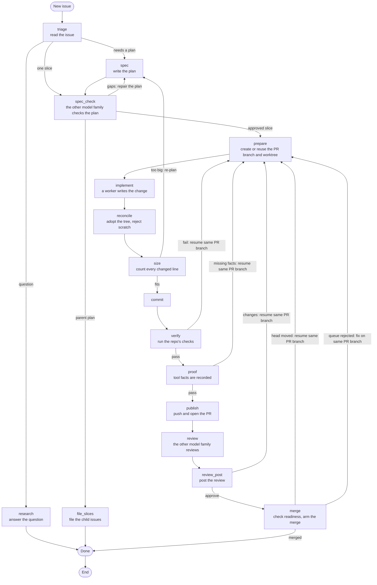
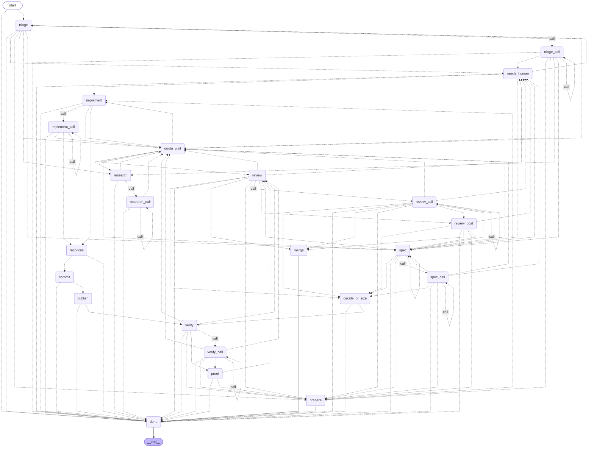

# Tools

Shared tools for the engine repositories. This repo lives in the bookout-labs organization. An engine does not copy it. The engine keeps a `tools.yaml` pointer.

`foreman` is the graph runner in this repo. Promptfoo grades the graph. Both are invoked from here, so every engine follows the same loop.

Design docs hold current design; PR evidence stays in the PR.

## Delivery graph

Outside-tool facts cited by review need recorded evidence at the verified head.
`foreman run delivery --fact-record evidence/facts.toml` selects a repository-relative
TOML record. The default is `tests/fixtures/manifest.toml`. On resume, omit the flag to use the saved path. An explicit path that differs from the saved path is an error. Fixture IDs name regular tracked files relative to the record.
When evidence is missing, implement receives the claims and recording schema and
can create the record. Unresolved claims carry stable IDs across reviews. Add each claim ID to the evidence
entry's `claim_ids` list to resolve it independently of later reviewer wording.
A typed exact restatement of the graph's verified check result needs no fixture.


<!-- graph:start -->
### Blueprint



Any step can pause (quota wait, human question, waiting on GitHub) and resumes at that step; review rounds are capped by max_review_rounds.

```mermaid
flowchart TD
  __start__([Dispatch]) --> plan
  plan["plan<br/>pick the next eligible model, check the budget, save the attempt"] --> call["call<br/>run one model"]
  call -->|quota or CLI missing: next model| plan
  call -->|no eligible model now| wait["wait<br/>pause until a model is available"]
  wait -->|resume| plan
  call -->|result| __end__([back to the assembly line])
```

### Today's code


<!-- graph:end -->

Regenerate the native drawings and this README with `foreman diagram --write`.
The approved blueprint is in `docs/graph/target.mmd`; `gaps.toml` records each topology difference and its closing slice.
The dispatch drawing stays empty until slice 13 builds the dispatch cell.
Changes to `docs/graph/` require Joe's written approval on the PR before merge.

The model list is `src/foreman/models.toml`. Quota exhaustion or a missing CLI tries the next model in that list. Review uses only the configured Opus and Sol list, preferring models outside all successful implementation families. Grok remains in the other model orders. A node does not edit the list, and it does not decide the next node.

Review keeps configured order within the preferred and contributing-family groups. A fresh invocation may review with the builder's own model, including a one-model configuration. The accepted attempt and round record the reviewer, contributing models, same-family flag, and fallback reason. The posted review includes that saved evidence, including after a posting retry. A review reports alignment, impact, verification, rollback, and error detection. It rates merge risk as low, medium, or high.

Round 1 reviews the full PR diff. Later rounds check unresolved findings and added
interdiff lines also in the PR diff. Out-of-scope findings become coordinator notes. Typed findings have stable IDs, kinds, fixes and
explicit resolutions. Resolved findings become settled rulings. Disagreements with
rulings become coordinator notes. The graph owns tool-fact checks separately from
reviewer findings. Rulings exist only within a run. The failure cap stays unchanged.

An unavailable PR or diff stops the run with `review_unavailable`. A failed GitHub review post stops it with `review_not_posted`. Invalid stage output stops with `invalid_output`. If every configured reviewer is out of quota or its CLI is missing, review stops with `reviewer_unavailable` (exit 75). Rerun the same command without `--answer` to select from the current review order again. Other stages retain `cli_missing` for missing CLIs. Missing implementation provenance still stops with `no_reviewer`. The future spec checker uses the same ordering rule against its actual author; its separate checker-unavailability contract is unchanged. The record includes `halt_detail` for these stops.

Foreman creates an `<issue>-<slug>` branch from the repository default branch before the first edit and commits each successful implementation. An attempt with no file changes stops with `failed`. Foreman adopts a clean, nonempty linear worker tree on the delivery branch by moving unpublished commits back to the attempt head with `git reset --soft`, then making its own commit with its message, attribution and redaction. Invalid history or a changed branch stops with `implementation_rejected` and preserves the checkout. Restore the delivery branch at the recorded attempt head with the intended edits, then rerun the same command. Other Git failures stop with `git_failed`. The publish node pushes the branch to the GitHub repository named by `--repo` and opens or reuses its pull request against the repository’s default branch. After `publish_failed`, rerun the same command to retry publication from the saved commit. Dry runs print the Git and GitHub commands they would use.

Live verify stops with `dirty_worktree` if the checkout has changes or Git cannot report a full HEAD SHA. Otherwise it runs the check command in the engine checkout and records that SHA if the check passes. Dry runs skip preflight and use a scripted verdict.

Use `--preflight <command>` to check environment readiness in the engine checkout. Each new or resumed invocation checks readiness once, just before its first implement dispatch. Routes that never reach implement skip the probe. After an ordinary check failure, Foreman runs preflight again if configured. A passing preflight leaves the check failure in the round count. A failing preflight stops the run as `env_unavailable` without consuming a round. Check exits 126 (command is not executable) and 127 (command not found) also stop as `env_unavailable`. The stop detail includes the failed command and its exit code.

Restore the environment and rerun the same command to resume from the saved checkpoint.

When the check passes, the graph evaluates the browser and formal evidence required by the slice. Missing evidence stops the run. A failed proof consumes a round and sends the slice back to implement while rounds remain.

The cap is three failures across slice planning, verify, proof, and review. It is config. A node cannot raise it.

After approval, Foreman looks up the pull request for the checked-out branch and arms it with `gh pr merge <pull-request> --repo <repo> --squash --auto --match-head-commit <sha>`. The worktree and pull request must still be at the verified SHA, the worktree must be clean, and the open pull request must target `main` from a branch starting with the issue number and a hyphen.

Foreman looks up the local branch by name. If the pull request uses a differently named upstream branch, the lookup fails and Foreman leaves the merge unarmed.

Before arming, Foreman reads the target repository's GitHub Actions variable `FOREMAN_MERGE_HOLD`. A non-empty value or a read error pauses the run as `merge_held` and records the value or error. An unset or empty value permits arming. Clear the hold or resolve the read error, then rerun the same command to retry the merge.

If the merge command times out, Foreman checks the same pull request at the verified SHA. An open pull request with a squash auto-merge request or a merged pull request confirms the result. A failed merge check or unconfirmed command pauses the run as `merge_not_armed` and records the reason. Resolve it and rerun the same command to retry. If HEAD moved, run `git reset --keep <verified-sha>` on the PR branch before rerunning. New commits need a new run. A dry run prints `merge skipped (dry run)` with the command template and reports the scripted verification result.

Stage prompts live in `src/foreman/stages/`. The graph selects worker methods from the rule table and validated delivery state.

Before live dispatch, Foreman exports the pstack skills from the repository and commit pinned in `src/foreman/config.py`. It records that pin in the checkpoint and reuses it on resume. A failed fetch or export stops with `skill_missing` and reports `pin unavailable` with the commit. A missing method in a successful export reports `method missing at pin` with the path and commit. Dry runs print `pstack pin not checked (dry run)`.

A parent or slice goes straight to implement when the behavior is decided and the change fits in one pull request. A parent on this route is its own slice. It carries the same proof obligations as any slice and files no child issues. Changes that need more than one pull request or leave a product choice open go to spec. An informational request goes to spec on a parent and to research on a slice. An open product choice pauses a live run for a person's answer.

A ready parent spec lists the seams each slice builds and uses. Foreman checks existing seam paths in the workspace and orders the slices so builders come first. A cycle, dangling seam, duplicate builder, or seam marked existing that a slice also builds sends the reason back to spec and uses a round. At the cap, the run stops as `spec_cap` without filing children. Single-slice parents skip ordering.

Foreman records the ordered plan and stops the parent as `sliced`. Each child issue carries a fenced JSON record of its slice and the parent's work classification, with native GitHub blocked-by links for its dependencies. A live slice run stops as `missing_slice` if the record is missing or invalid. It reports `blocked` before triage while a blocker is open, a planned link is missing, or a planned blocker has no merged pull request. Run the same slice again after its blockers clear. Rerunning the parent restores missing links and adds the `factory` label when a dependent slice is ready.

```json
{
  "title": "Keep the selected item on refresh",
  "acceptance": "The selected item remains selected after refresh.",
  "depends_on": [],
  "screen": "",
  "properties": [],
  "stateful": true,
  "work_kind": "bug_fix"
}
```

`stateful` is a boolean. `work_kind` is one of `feature`, `bug_fix`, `refactoring`, or `perf_issue`. Old issues without these fields default to a stateless slice and get their classification during triage. A `slice`-labelled issue with a missing or invalid JSON object stops at `missing_slice`.

Start the human-facing coordinator with `foreman coordinator` from the engine's
working directory. It starts interactive Claude Code with the installed package's
`roles/coordinator.md` appended to its system prompt. Terminal input and output
stay attached. The session files the parent issue and explains the run. It does
not slice, build, or arm a merge. Graph workers keep their stage instructions.

Install Claude Code and authenticate it first. The operator supplies the selected
tools installation, for example by installing `bookout-tools` from the exact Git
commit named by the engine's tools pointer into a dedicated virtual environment.
Invoke that environment's `foreman coordinator`. This command does not resolve or
install the pointer's ref, and a global `foreman` may belong to a different revision.
A missing, unreadable, or empty packaged role stops startup with an error before
Claude launches.

The factory label is the delivery trigger contract. A host integration must still
route GitHub label events through `foreman accept` and launch accepted runs;
`foreman coordinator` does not install a webhook or start a polling loop.

After reporting a halted live run, Foreman watches eligible failures by filing a proposed fix or commenting on the existing open proposal for that cause. It records the watch in SQLite and uses a run marker to avoid duplicate writes after a crash; a new halt can add fresh evidence. `--watch-repo OWNER/NAME` selects the proposal repository (default `bookout-labs/tools`). Skipped halts and watch failures are logged without changing the run's exit code; failures retry on the next invocation. Dry runs never contact Forge.

`foreman run` exits 0 for successful stops (`done verified`, `done sliced`, or `done answered`), 3 for `needs_human` (including a live run paused for `--answer`), 75 for a resumable halt (`merge_held`, `merge_not_armed`, `env_unavailable`, or `reviewer_unavailable`), and 1 for every other halt.

## What enters the graph

`foreman accept` reads one event and either ignores it or prints the request. It does not call a model.

A GitHub event starts when it is `issue_labeled` and the labels include `factory`. The command ignores other GitHub events. It rejects unknown sources.

```yaml
source: github
event: issue_labeled
labels: [factory]
title: Encode the timecode
body: The comment thread crashes.
```

```sh
foreman accept event.yaml
```

Promptfoo runs the same contract without a model:

```sh
sh evals/eval.sh
```

## Point an engine at it

Put this file at the root of the engine and name it `tools.yaml`.

```yaml
source: bookout-labs/tools
ref: main
graph: delivery
check: npm run check
```

Examples for the current engines are in `examples/`. `ref` should move from `main` to a tag once a graph change should wait for the engine to opt in.

Check a pointer:

```sh
foreman check-pointer tools.yaml
```

Walk the graph without calling a model:

```sh
foreman run delivery --dry-run --repo DoctorCRE/doctorcre-engine --request "Add a field" --check "npm run check"
```

Print the graph:

```sh
foreman diagram delivery
```

Start a live run from the root of the engine checkout. Use `--request` to supply the issue text when it is not available in the checkout.

```sh
foreman run delivery --repo DoctorCRE/doctorcre-engine --issue 42 --check "npm run check" --request "Add a field"
```

Foreman creates the slice branch from the repository default branch, checkpoints worker edits, commits them, pushes to the checkout's `origin`, and opens or reuses the branch's pull request. Both origin fetch and push URLs must identify `--repo`. For HTTPS, configure GitHub CLI authentication with `gh auth setup-git` before running. Git calls cannot prompt for credentials. Run the same issue again to resume after a quota stop, temporary Git failure or publication failure. Keep the run's partial edits in place.

The runner uses the pinned model slugs from `models.toml` with the installed Codex, Claude, and Grok CLIs. SQLite saves state by repo and issue under `$XDG_STATE_HOME/foreman/checkpoints.sqlite3`, or `~/.local/state/foreman/checkpoints.sqlite3` by default. Run the same issue again from the same checkout to see its saved state. If you see a question, add `--answer "…"` to continue with the saved request, check command, and any preflight command.

If the live command prints `paused quota_exhausted`, run it again from the same checkout after quota returns. Foreman retries the same stage and retains its earlier attempt records. Review instead prints `done reviewer_unavailable` (exit 75) when all eligible reviewers are unavailable. Rerun after restoring quota or the missing CLI; review reselects from the current model table.

Before review, Foreman fetches the pull request's base branch from `origin` and counts added and deleted lines across every path against the merge base, including root files, docs, and logs. Use Git 2.43 or later.

Reconciliation and size use the merge base with fetched `refs/remotes/origin/<base>`. Reconciliation rejects added or modified deliverable paths matching that base's `.gitignore` files, including staged files and worker commits. Ignored untracked files stay outside the delta; deleting tracked scratch is allowed. Here, `evidence/` declares disposable worker output. The default and configured fact records and their named regular captures remain deliverables, without exempting adjacent files. `implementation_rejected` names rejected paths and preserves the checkout. Remove the scratch and rerun to reconcile again without repeating the implement call.

Files marked `linguist-generated` by [`.gitattributes`](.gitattributes) at the merge base do not count. Here, that means fixtures, generated schemas, and lockfiles. Candidate attribute changes cannot exempt their own lines.

Pure renames add no lines. For renames across an exclusion boundary, only the handwritten side counts. Binary files count through Git's text diff. If Foreman presents a split plan, use `--answer split` to accept it or `--answer override` to continue with that measured diff.


## Tests

```sh
uv sync
uv run python -m unittest discover -s tests
```

### Run limits

`foreman run delivery --max-budget-usd X` stores an optional Claude dollar
allowance. The amount must be finite and positive (for example, `1.50` or
`1e-4`); it is saved as canonical decimal text. Omitting the flag on a new run
stores an unbounded allowance. On resume, omit the flag to keep the saved value,
or supply an equal amount. A different amount, including adding a bound to an
unbounded run, is an error.

Bounded runs print `claude spend $S of $L`. This total includes Claude attempts
across resumes, including failed and quota attempts, but excludes missing CLIs
and Codex or Grok costs. If any counted attempt lacks a dollar cost, the display
is `claude spend unknown of $L`. Resumable checkpoints predating the stored
dollar allowance require a new run; finished legacy runs remain readable.

Claude dispatches receive the remaining allowance through `--max-budget-usd`.
Reaching the allowance halts `budget_exceeded` before output or fallback.
Unknown Claude costs halt bounded runs as `cost_unknown`. Missing CLIs fall through.
Both halts exit 1. Dry runs record zero dollar cost.

`foreman run delivery --max-tokens N` stores a positive token cap, defaulting to
20,000,000. Resume keeps the stored cap and rejects a differing flag.
Each dispatch checks the sum of all attempt input, output, cache read and cache
creation tokens. The attempt already in flight can overshoot the cap. Once the
cap is reached, no subsequent model runs and that attempt's output is not
applied. `budget_exceeded` and `usage_unknown` exit 1 and cannot resume.
Interrupted calls with no committed usage halt as unknown rather than being
retried. Checkpoints from before usage accounting require a new run.

Claude's `error_max_budget_usd` result also halts as `budget_exceeded`, retaining
the attempt's usage without applying its output or trying the next model.
It precedes missing usage and the token cap. Otherwise missing successful usage
halts first, then the token cap, then the dollar allowance.
Claude dollar costs are known only when every model ledger cost is finite and
nonnegative and their sum agrees with the envelope total within floating-point
tolerance; invalid costs leave token accounting intact.

Settled rulings exist only within a run. Resolved findings become rulings for later reviews.

A repeated blocking kind pauses as `design_rethink` without consuming a failure round.
A design answer resumes implementation and becomes a settled ruling in the next review.
