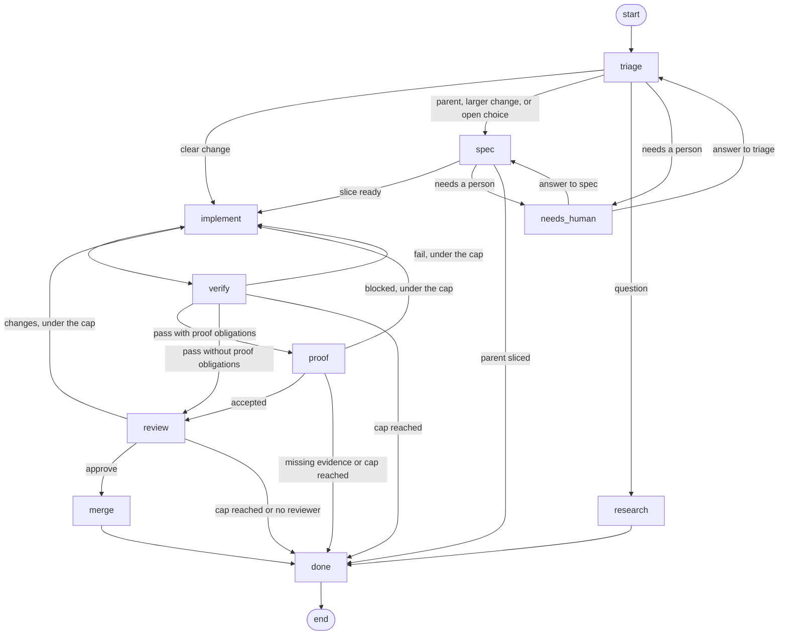

# Tools

Shared tools for the engine repositories. This repo lives in the bookout-labs organization. An engine does not copy it. The engine keeps a `tools.yaml` pointer.

`foreman` is the graph runner in this repo. Promptfoo grades the graph. Both are invoked from here, so every engine follows the same loop.

## Delivery graph



The edges are code. The model list is `src/foreman/models.toml`. Quota exhaustion tries the next model in that list. A node does not edit the list, and it does not decide the next node.

Review uses a different model family from the model that implemented the change. A review reports alignment, impact, verification, rollback, and error detection. It rates merge risk as low, medium, or high. Invalid stage output stops with `invalid_output`. If the builder model is missing or every eligible reviewer is unavailable, the run stops with `no_reviewer`. The record includes `halt_detail` for both stops.

Verify runs the check command in the engine checkout and uses its exit code. Dry runs use a scripted verdict. When the check passes, the graph evaluates the browser and formal evidence required by the slice. Missing evidence stops the run. A failed proof consumes a round and sends the slice back to implement while rounds remain.

The cap is three failures across verify, proof, and review. It is config. A node cannot raise it.

After approval, the merge node records `gh pr merge --auto --match-head-commit <sha>` if the builder reported a full head SHA. The CLI records the command locally. The runner can pass those arguments to an injected GitHub command handler.

Stage prompts live in `src/foreman/stages/`. The code-quality skill supplies the scorer rubric. The merge-risk skill is attached to review. A node reads those files. It does not invent the loop.

A clear change on a slice goes straight to implement. Parent issues and changes that need more than one pull request route to spec even when the decisions are settled. A ready parent spec records its slices and stops as `sliced`. Each slice records its title, acceptance, dependency titles, screen path or empty string, and named property constraints. An open product choice pauses a live run for a person's answer. An informational request routes to research.

A coordinator session reads `src/foreman/roles/coordinator.md` from the tools revision named in the engine. It files the parent issue and explains the run. It does not slice, build, or arm a merge.

## What enters the graph

`foreman accept` reads one event and either ignores it or prints the request. It does not call a model.

A GitHub event starts when it is `issue_labeled` and the labels include `factory`. The command ignores alerts and other GitHub events. It rejects unknown sources.

```yaml
source: github
event: issue_labeled
labels: [factory]
title: Encode the timecode
body: The comment thread crashes.
```

```sh
foreman accept event.yaml
```

## Scoring

`src/foreman/measure.toml` holds the sampling rate, the passing bar, and the label scores. One implementation run in every ten is sampled for scoring. Merge arming uses verification and review independently of scoring.

- `approve` scores 1 and passes.
- `block` scores 0.2 and fails. A produced artifact that fails its proof or screen check is `block`.
- `insufficient_evidence` scores 0.5 and always remains a distinct non-pass. A missing required proof or browser trace leaves the work unjudged.

`foreman improve` proposes a change for a known scoring failure. For redundant tests, it targets the builder instructions in `src/foreman/stages/implement.md`. The proposal does not change `models.toml` or the review cap. A person opens the pull request.

```sh
foreman improve redundant-tests
```

Promptfoo runs the same contract without a model:

```sh
sh evals/eval.sh
```

## Point an engine at it

Put this file at the root of the engine and name it `tools.yaml`.

```yaml
source: bookout-labs/tools
ref: main
graph: delivery
check: npm run check
```

Examples for the current engines are in `examples/`. `ref` should move from `main` to a tag once a graph change should wait for the engine to opt in.

Check a pointer:

```sh
foreman check-pointer tools.yaml
```

Walk the graph without calling a model:

```sh
foreman run delivery --dry-run --repo DoctorCRE/doctorcre-engine --request "Add a field" --check "npm run check"
```

Print the graph:

```sh
foreman diagram delivery
```

Start a live run from the root of the engine checkout. Use `--request` to supply the issue text when it is not available in the checkout.

```sh
foreman run delivery --repo DoctorCRE/doctorcre-engine --issue 42 --check "npm run check" --request "Add a field"
```

The runner uses the pinned model slugs from `models.toml` with the installed Codex, Claude, and Grok CLIs. SQLite saves state by repo and issue under `$XDG_STATE_HOME/foreman/checkpoints.sqlite3`, or `~/.local/state/foreman/checkpoints.sqlite3` by default. Run the same issue again from the same checkout to see its saved state. If you see a question, add `--answer "…"` to continue with the saved request and check command.

## Tests

```sh
uv sync
uv run python -m unittest discover -s tests
```
