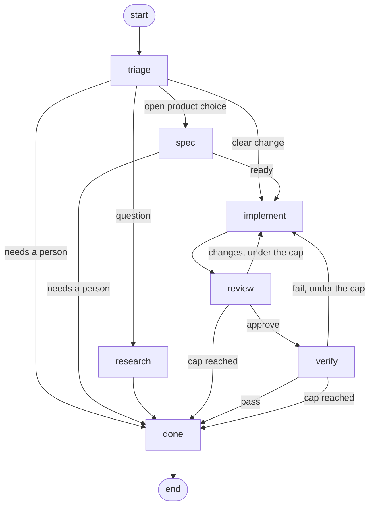

# Tools

Shared tools for the engine repositories. This repo lives in the bookout-labs organization. An engine does not copy it. The engine keeps a `tools.yaml` pointer.

`foreman` is the graph runner in this repo. Promptfoo grades the graph. Both are invoked from here, so every engine follows the same loop.

## Delivery graph



The edges are code. The model list is `src/foreman/models.toml`. Quota exhaustion tries the next model in that list. A node does not edit the list, and it does not decide the next node.

Review uses a different model family from the model that implemented the change. A review also reports merge risk: alignment, impact, verification, rollback, and error detection, plus a level of low, medium, or high. A review without that report does not continue.

The check command comes from the engine's pointer and is attached to verify. Verify has no model. A live run is not connected, so this node does not execute the command yet.

The cap is three review or verify failures. It is config. A node cannot raise it.

Stage prompts live in `src/foreman/stages/`. The code-quality skill is attached to implement. The merge-risk skill is attached to review. A node reads those files. It does not invent the loop.

A clear change on a slice goes straight to implement. A parent issue stops after spec returns its slices. The runner files those issues. The parent is not implemented. A product choice stops on the spec until it is ready. A question is answered and does not change code.

A coordinator session reads `src/foreman/roles/coordinator.md` from the tools revision named in the engine. It files the parent issue and explains the run. It does not slice, build, or arm a merge.

## What enters the graph

`foreman accept` reads one event and either ignores it or prints the request. It does not call a model.

A GitHub event starts when it is `issue_labeled` and the labels include `factory`. An alert starts from a title and a body. Anything else is ignored or rejected.

```yaml
source: github
event: issue_labeled
labels: [factory]
title: Encode the timecode
body: The comment thread crashes.
```

```sh
foreman accept event.yaml
```

## Scoring

`src/foreman/measure.toml` holds the sampling rate, the passing bar, and the label scores. One implementation run in every ten is graded. `approve` scores 1 and passes. `block` scores 0.2 and fails. `insufficient_evidence` scores 0.5 and is reported on its own. It is not evidence of good work.

`foreman improve` turns a known failure into a proposed skill change. The proposal does not change `models.toml` or the review cap. A person opens the pull request.

```sh
foreman improve redundant-tests
```

Promptfoo runs the same contract without a model:

```sh
sh evals/eval.sh
```

## Point an engine at it

Put this file at the root of the engine and name it `tools.yaml`.

```yaml
source: bookout-labs/tools
ref: main
graph: delivery
check: npm run check
```

Examples for the current engines are in `examples/`. `ref` should move from `main` to a tag once a graph change should wait for the engine to opt in.

Check a pointer:

```sh
foreman check-pointer tools.yaml
```

Walk the graph without calling a model:

```sh
foreman run delivery --dry-run --repo DoctorCRE/doctorcre-engine --request "Add a field" --check "npm run check"
```

Print the graph:

```sh
foreman diagram delivery
```

A run without `--dry-run` stops. No live model dispatcher is connected yet.

## Tests

```sh
uv sync
uv run python -m unittest discover -s tests
```
