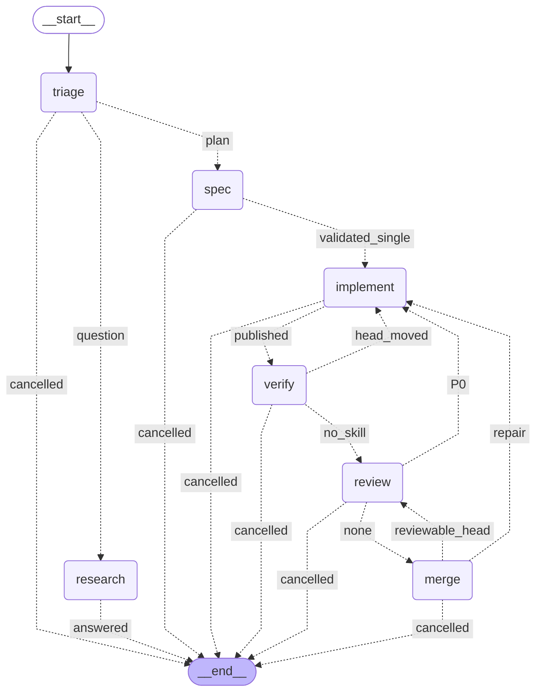

# Tools

Shared tools for the engine repositories. This repo lives in the bookout-labs organization. An engine does not copy it. The engine keeps a `tools.yaml` pointer.

`foreman` is the graph runner in this repo. Promptfoo grades the graph. Both are invoked from here, so every engine follows the same loop.

Design docs hold current design; PR evidence stays in the PR.

## Delivery graph

Run `foreman run delivery --repo <owner>/<name> --issue <number>` for a target repository that carries a contract file, `.foreman/contract.yaml`.

[The v2 blueprint](docs/graph/blueprint/README.md) defines the target and explains the projection check.

<!-- graph:start -->
### Today's code


<!-- graph:end -->

Regenerate the compiled delivery drawing and this README with `foreman diagram --write`.
Changes to `docs/graph/` require the code owner's written approval on the PR before merge.

The model list is `src/foreman/models.toml`. Quota exhaustion or a missing CLI tries the next model in that list. Review uses only the configured Opus and Sol list, preferring models outside all successful implementation families. Grok remains in the other model orders. A node does not edit the list, and it does not decide the next node.

Review keeps configured order within the preferred and contributing-family groups. A fresh invocation may review with the builder's own model, including a one-model configuration. The accepted attempt and round record the reviewer, contributing models, same-family flag, and fallback reason. The posted review includes that saved evidence, including after a posting retry.

Every round reviews the full PR diff from its pinned merge base to its checked head.
The reviewer cites committed locations and gives the severity, impact and evidence for
each finding. Foreman posts a COMMENT for each report. Only concrete P0 or P1 correctness,
security or scope defects send the same PR back for repair. Other findings remain advisory.
Honor applicable settled rulings.

A PR or diff that cannot be read stops the run with `git_failed`. A failed GitHub review post stops it with `review_not_posted`. Invalid stage output gets one repair turn in the same session with the exact validation error, and a second invalid answer stops with `invalid_output`. Every stage shares one dispatch: a quota stop or missing CLI moves to the next qualified model, and the run halts with `worker_unavailable` (exit 75) only when none is left. Missing implementation provenance still stops with `no_reviewer`. The independent spec checker prefers a different model family from the accepted draft author. The record includes `halt_detail` for these stops.

Implement runs four steps: prepare, edit, commit and publish. Prepare creates an `<issue>-<slug>` branch from the pinned base before the first edit. Edit reconciles the builder's candidate and runs the check command on that exact tree. A failed check sends the output back to the builder for another round, and a check that changes the tree fails the same way. A passing check binds the tree, and commit publishes only that tree. Foreman reports the changed-line count but does not block on it. An attempt with no file changes stops with `no_change`. Foreman adopts a clean, nonempty linear worker tree on the delivery branch by moving unpublished commits back to the attempt head with `git reset --soft`, then making its own commit with its message, attribution and redaction. Invalid history or a changed branch stops with `implementation_rejected` and preserves the checkout. Restore the delivery branch at the recorded attempt head with the intended edits, then rerun the same command. Other Git failures stop with `git_failed`. The publish node pushes the branch to the GitHub repository named by `--repo` and opens or reuses its pull request against the repository’s default branch. After `publish_failed`, rerun the same command to retry publication from the saved commit. Dry runs print the Git and GitHub commands they would use.

Commit and publish stop with `dirty_worktree` if the checkout differs from the checked tree or HEAD differs from the expected commit. Publish observes the remote branch and pull request before every push or create, so a crash never repeats a completed write. A remote head that moved on the owned pull request starts a new attempt without the earlier check or review authority. Unrecognized remote work stops with `publish_failed`, and a write that GitHub cannot yet confirm stops with `publication_unreconciled`. Dry runs skip preflight and use a scripted verdict.

Set the `FOREMAN_PREFLIGHT` repository variable to a command that checks environment readiness in the engine checkout. A new run saves the value its start read, and a resume keeps it. Each new or resumed invocation checks readiness once, after checkout validation and before its first implement dispatch. Review answers resume through prepare, so environment retries retain the answer and implementer history. Routes that never reach implement skip the probe. After an ordinary check failure, Foreman runs preflight again if configured. A passing preflight leaves the check failure in the round count. A failing preflight stops the run as `env_unavailable` without consuming a round. Check exits 126 (command is not executable) and 127 (command not found) also stop as `env_unavailable`. The stop detail includes the failed command and its exit code.

Restore the environment and rerun the same command to resume from the saved checkpoint.

A passing repository check goes directly to publication at the checked head. Keep any
additional evidence required by the slice in the issue or repository checks. Each of
slice planning, verification and blocking review uses the configured failure cap.

After approval, Foreman looks up the pull request for the checked-out branch and arms it with `gh pr merge <pull-request> --repo <repo> --squash --auto --match-head-commit <sha>`. The worktree and pull request must still be at the verified SHA, the worktree must be clean, and the open pull request must target `main` from a branch starting with the issue number and a hyphen.

Foreman looks up the local branch by name. If the pull request uses a differently named upstream branch, the lookup fails and Foreman leaves the merge unarmed.

Before arming, Foreman reads the target repository's GitHub Actions variable `FOREMAN_MERGE_HOLD`. A non-empty value or a read error pauses the run as `merge_held` and records the value or error. An unset or empty value permits arming. Clear the hold or resolve the read error, then rerun the same command to retry the merge.

If the merge command times out, Foreman checks the same pull request at the verified SHA. An open pull request with a squash auto-merge request or a merged pull request confirms the result. A failed merge check or unconfirmed command pauses the run as `merge_not_armed` and records the reason. Resolve it and rerun the same command to retry. If HEAD moved, run `git reset --keep <verified-sha>` on the PR branch before rerunning. New commits need a new run. A dry run prints `merge skipped (dry run)` with the command template and ends `done merge_pending`, where a live run waits for GitHub.

The merge stage waits on GitHub, not on a worker. Pending checks pause the run as `merge_pending`; rerunning the same command restarts the merge stage, reads readiness once and repeats no worker call. Red checks, a conflict or a merge-queue rejection send GitHub's evidence back to implement as a repair, which is reviewed again before it is armed. A base that moved before arming gets a fresh review. A head that moved after arming is repaired when it descends from the checked head, and otherwise a person is asked. Only GitHub's confirmed merge of the reviewed head ends the run as `merged`. A merge of any other head ends as `merged_unreviewed`, with no credit or release, and files a watch issue. The run then names each open issue this one blocked, in any repository, as a `start` line, and admission decides each one. A pull request closed without merge ends as `closed`.

Stage prompts live in `src/foreman/stages/`. The graph selects worker methods from the rule table and validated delivery state.

Before live dispatch, Foreman exports the pstack skills from the repository and commit pinned in `src/foreman/config.py`. It records that pin in the checkpoint and reuses it on resume. A failed fetch or export stops with `skill_missing` and reports `pin unavailable` with the commit. A missing method in a successful export reports `method missing at pin` with the path and commit. Dry runs print `pstack pin not checked (dry run)`.

Triage admits the issue and classifies it. A decided change that fits in one pull request is a supplied slice: a parent on this route is its own slice, carries the slice acceptance and files no child issues, and a `slice` issue supplies its own record. Spec validates a supplied slice and has it checked before implement. A change that needs more than one pull request or leaves a product choice open is a plan, which spec drafts. An informational request goes to research, which posts one answer comment on the issue. An open question pauses a live run for a person's answer.

A ready parent spec lists the seams each slice builds and uses. Foreman checks existing seam paths in the workspace and orders the slices so builders come first. A cycle, dangling seam, duplicate builder, or seam marked existing that a slice also builds sends the reason back to spec and uses a round. At the cap, the run stops as `spec_cap` without filing children. Single-slice parents skip ordering.

Foreman files the checked plan as child issues in dependency order and stops the parent as `children_filed`. Each child issue carries a marker for its parent and title, a fenced JSON record of its slice and the parent's work classification, a sub-issue link to the parent, and native GitHub blocked-by links for its dependencies. Children are created with only the `slice` label. Once every child and link is confirmed, Foreman adds the `Ready` label to every child that shows no run label yet and names each child as a `start` line. Admission keeps a child unadmitted while its blockers are open. After a crash or a failed write, rerunning the parent reads GitHub by marker first and writes only what is missing. Duplicate markers, a child with a different body or parent, or a write that GitHub doesn't show stop the parent as `publication_unreconciled`. A live slice run stops as `missing_slice` if the record is missing or invalid. Admission stops it as `blocked` while a blocker is open, a planned link is missing, or a planned blocker has no merged pull request.

```json
{
  "title": "Keep the selected item on refresh",
  "acceptance": "The selected item remains selected after refresh.",
  "depends_on": [],
  "screen": "",
  "properties": [],
  "stateful": true,
  "work_kind": "bug_fix"
}
```

`stateful` is a boolean. `work_kind` is one of `feature`, `bug_fix`, `refactoring`, or `perf_issue`. Old issues without these fields default to a stateless slice and get their classification during triage. A `slice`-labelled issue with a missing or invalid JSON object stops at `missing_slice`.

Start the human-facing coordinator with `foreman coordinator` from the engine's
working directory. It starts interactive Claude Code with the installed package's
`roles/coordinator.md` appended to its system prompt. Terminal input and output
stay attached. The session files the parent issue and explains the run. It does
not slice, build, or arm a merge. Graph workers keep their stage instructions.

Install Claude Code and authenticate it first. The operator supplies the selected
tools installation, for example by installing `bookout-tools` from the exact Git
commit named by the engine's tools pointer into a dedicated virtual environment.
Invoke that environment's `foreman coordinator`. This command does not resolve or
install the pointer's ref, and a global `foreman` may belong to a different revision.
A missing, unreadable, or empty packaged role stops startup with an error before
Claude launches.

The Ready label is the delivery trigger contract. `foreman receive` is the receiver: plain code that takes the App's
webhook deliveries, so no model session receives, carries or reads one. `foreman coordinator` does not install a
webhook or start a polling loop.

After reporting a halted live run, Foreman watches eligible failures by filing a proposed fix or commenting on the existing open proposal for that cause. It records the watch in SQLite and uses a run marker to avoid duplicate writes after a crash; a new halt can add fresh evidence. `--watch-repo OWNER/NAME` selects the proposal repository (default `bookout-labs/tools`). Skipped halts and watch failures are logged without changing the run's exit code; failures retry on the next invocation. Dry runs never contact Forge.

`foreman run` exits 0 for successful stops (`done merged`, `done children_filed`, `done answered`, or a dry run's `done merge_pending`), 3 for `needs_human` (including a live run paused for `--answer`), 75 for a merge wait (`paused merge_pending`) or a resumable halt (`merge_held`, `merge_not_armed`, `readiness_unavailable`, `worker_unavailable`, or `env_unavailable`), and 1 for every other stop, including a pull request closed without merge.

## What enters the graph

`foreman accept` reads one GitHub delivery and prints `ignored`, the issue to start or each issue to wake, comma-separated. It exits 1 on an unreadable or malformed delivery. It does not call a model.

`foreman receive` listens on `127.0.0.1:8787` (`--host` and `--port` change it) for the App's webhook POSTs. It reads the webhook secret from the owner-only file `FOREMAN_WEBHOOK_SECRET_PATH` names (default `~/.config/bookout-foreman/webhook-secret`) and never prints it. A delivery whose `X-Hub-Signature-256` does not sign its body gets 401 before `accept` reads it, and a body that is not a delivery gets 400. Every other delivery goes to `accept` unchanged and gets 202 with `accept`'s line, which the receiver also prints after the `X-GitHub-Delivery` id. An ignored delivery starts nothing and prints that one line. A body larger than GitHub's 25 MB payload cap gets 413 before the receiver reads it, and a connection that has not sent its body within 10 seconds gets 408, so a stalled connection delays no other delivery. A start or wake runs `foreman start` or `foreman wake` in its own process, which shares the receiver's output; the receiver prints `<line> exited <code>` when that process exits non-zero. Deliveries are decided one at a time. Runs of different issues go on at the same time, and the issue's lock serializes runs of one issue. `foreman accept` stays for tests and for deciding a saved delivery by hand.

`foreman smoke` runs on the same host as the receiver and under the same user, so both use the same state directory. For each smoke repository it files the issue as the App without Ready, then adds Ready with the host's own `gh` session, which must be signed in as the repository's `FOREMAN_HUMAN_LOGIN`. That label's delivery starts the run through the receiver, and only GitHub's deliveries move it on. The smoke reads the saved run each time the state directory's checkpoint store changes, and it passes once the run has merged after at least one wake. A run saves, at its first start, the commit of the Foreman code that started it, and a resume or a wake never replaces it. The smoke proves only the commit it runs from, so run it from a clean checkout of the commit the receiver is pinned to. It is unavailable (exit 78) when nothing answers on the receiver's port, `gh` is signed in as another login, its own checkout has tracked changes, or the run saved another commit or none; it then names both commits. It fails at its deadline when a delivery does not come.

A delivery starts a run when its `X-GitHub-Event` is `issues`, its action is `labeled`, the label it adds is `Ready`, and the issue is not a pull request. Any other label added to an issue that already carries Ready is ignored. Admission then re-reads the issue from GitHub and admits it only while it still carries Ready, so a delivery that outlived its label leaves the issue unadmitted.

```sh
foreman accept --event issues delivery.json
# start Example/Engine#7
foreman start --repo Example/Engine --issue 7
```

A delivery wakes an open run when its event is `issue_comment`, its action is `created`, the issue is not a pull request, and the comment's author is the login the run saved at its last start. A `foreman stop` comment wakes the run whatever it is doing: running, waiting, paused at a gate or halted. A run paused at a gate also wakes when the comment's first line is exactly the question's `foreman answer` line. An edit, another login's comment, a comment without the marker, a delivery that comes after the question closed and a delivery for a run that ended with a result other than a halt are ignored. `accept` reads the delivery's `action`, `issue.number`, `issue.pull_request`, `repository.full_name`, `comment.user.login` and `comment.body`, and the run's checkpoint.

```sh
foreman accept --event issue_comment delivery.json
# wake Example/Engine#7
foreman wake --repo Example/Engine --issue 7
```

A run in merge, whatever its step, also wakes on GitHub's merge events. A `pull_request` or `pull_request_review` delivery, whatever its action, wakes the run whose saved pull request has the delivery's `pull_request.number`, which is not the issue's number. A `check_suite` delivery with action `completed`, or any `status` delivery, wakes every run in merge in `repository.full_name`, because GitHub may record a required check on the pull request's test merge commit, which no run saves. Whether a run is in merge is read from its checkpoint without its lock: the stage the saved run has under way or is paused in, or for a halted run the stage its halt came from. A run in any other stage, or one that ended with a result other than a halt, is not woken. The delivery carries nothing into the wake, so it is the same wake a comment sends and decides once it holds the run's lock: a run that waits in arm or observe reads GitHub again and decides from that read, and a run halted or paused at a gate in merge reads the pull request and then the issue, so a stop or an answer whose own delivery was lost is handled as below. Otherwise nothing resumes and nothing is written.

```sh
foreman accept --event check_suite delivery.json
# wake Example/Engine#7, wake Example/Engine#9
```

GitHub sends no event when it has computed whether a pull request can be merged, so merge's step reads it again for up to a minute and then halts `readiness_unavailable`, which Ready added again reads again. A required check that is still pending waits for its delivery.

`foreman wake` acts only as the App and takes the issue's lock as `foreman start` does, so a stop posted while the run is running is handled when the run stops running. A wake for an issue with no run, or whose run ended with a result other than a halt, prints `not waiting`, exits 0 and reads and writes nothing, so it never starts or resumes a run. Every other wake reads the issue for a stop before anything resumes; in merge it reads the pull request first. A stop that counts ends a waiting, gate-paused, halted or interrupted run cancelled and closes its open pull request, except that a stop after the pull request merged is too late: the run records it, stays as it was and its status comment says so. When one of those reads, or the close of the pull request, fails, nothing changes and the status comment shows a `git_failed` report above the run's state, saying what to do next. Otherwise the wake continues a run that waits, with the answer it reads from the issue, and resumes nothing else: a halted run, or one whose process died in the middle of a step, stays as it was. It runs no doctor, reads no login or cap variable, and exits as `foreman run` does. Ready added to a paused run still prints `already started`.

`foreman start` begins an accepted issue's run with nobody at the keyboard:
- It acts only as the GitHub App installed on that repository and never falls back to a personal `gh` login.
- It takes the issue's lock first, waiting while another Foreman process holds it. An existing checkpoint for that issue then prints `already started` and exits 0, so a repeated delivery never resumes a running, paused or waiting run. A run that ended cancelled is replaced by a new run when the issue carries Ready again; a stale delivery finds it without Ready and prints `already started`, as does Ready added after any other ended run. A run that stopped on a resumable halt, `budget_exceeded` included, resumes at its halted step in its saved checkout with the repository's current settings. An interrupted run, one whose process died in the middle of a step, resumes at that step with the login and caps this start read, which replace the saved ones. A worker call it had sent and that left no result has an unknown spend, so it is charged once, with the allowance saved on its reservation. When the caps this start read leave room, the call is made again within what is left, from its original instructions in a fresh session, on the files the cut-off call left, provided the checkout is still on the owned branch at the attempt's parent; otherwise the run stops `dirty_worktree` and the status comment says how to put the checkout back. When they leave no room, the run halts `budget_exceeded`, and Ready after the caps are raised makes the call. A stop that ends an interrupted run shows the cut-off call in its report as interrupted, with unknown tokens and dollars.
- After a run returns, `foreman start` and `foreman run` print one `start OWNER/NAME#N` line for each issue the run returns to admission: the open dependents after its merge, or the children it filed. After the run's process exits, the receiver reads the same issues from the run's checkpoint, never from its output, and starts each like an accepted delivery, each in its own process. Admission decides from the issue's Ready label and its prerequisites. A replayed delivery for a finished run reads the same saved issues, so a crash before the receiver starts them loses nothing. A prerequisite counts once its closing pull request merged into the default branch.
- It reads the operator's settings from the repository's GitHub Actions variables:
  - `FOREMAN_HUMAN_LOGIN` is required: the GitHub login whose issue comments answer or stop the run.
  - `FOREMAN_MAX_TOKENS` defaults to the standard token cap.
  - `FOREMAN_MAX_BUDGET_USD` defaults to $3.
  - `FOREMAN_MERGE_HOLD` holds merge arming while it is set. Foreman reads it at arm time.
- `FOREMAN_PREFLIGHT`, an optional command run before the check, stays a variable until the contract's setup commands replace it.
- A missing login, a malformed value or an unreadable variable list stops with exit 1 before any run. The checkpoint pins the settings when the run starts.
- The check command and the verify skill come from the repository's contract file, `.foreman/contract.yaml`, at the base commit admission pins. A branch that changes the file never changes its own run's check. The file parses strictly: an unknown or duplicate key, or a malformed field, is named. It requires `check` and `verify_skill`, the path of a tracked verify skill. A missing or invalid contract file, or no tracked skill at `verify_skill`, stops admission as `not_ready` with the missing requirement and its fix on the issue. The issue keeps Ready, so supply the requirement, then remove and add the Ready label.
- The run works in its own checkout, not the current directory. Each repository has one shared clone at `$XDG_STATE_HOME/foreman/checkouts/<owner>/<name>`. Admission adds the issue's worktree at `$XDG_STATE_HOME/foreman/runs/<owner>/<name>/<issue>`, detached at the pinned base, so an issue that isn't admitted gets no checkout. A finished run removes a clean worktree. A halted run keeps it as evidence.
- Resume with `foreman run --repo <owner>/<name> --issue <n> --answer ...` from any directory. It uses the issue's checkout and the checks its contract supplied at admission.

### What the issue shows

Foreman mirrors each admitted run onto its issue with one run label and one status comment, like Warp's progress in the originating issue ([GitHub integration](https://docs.warp.dev/factories/integrations/github/)). The run's checkpoint decides. A label never grants authority, and a human label change is corrected by the next write.

| Run | Label | Status comment |
|---|---|---|
| Unadmitted (`blocked`) | `Ready` stays | none |
| Halted before admission, or a missing setting | `Ready` stays | the reason |
| A stage runs, or waits for the merge | `Doing` | the stage and its wait |
| `needs_human` | `Needs answer` | the question and its `foreman answer` line |
| A halt after admission | `Stopped` | the halt with its detail and watch issue |
| A finished outcome | `Done` | the outcome with its pull request, verified head, merge commit and released issues |

- The status comment ends with `<!-- foreman status -->`. Foreman edits its own marked comment, only when the text changed, and ignores a human comment that quotes the marker.
- Foreman removes the other run labels, adds the target label only when it is missing and keeps every other label. It creates a missing label before adding it and never changes an existing label's color.
- A replay of a finished run writes nothing, and a crash between the label and the comment converges on the next invocation. A failed write is logged and never changes the run.
- `foreman accept` ignores deliveries sent by Foreman's App, like Warp's default of skipping bot events ([triggers](https://docs.warp.dev/factories/automation-triggers/)), so a child that Spec labels `Ready` starts once, from its `start` line.

Promptfoo runs the same contract without a model:

```sh
sh evals/eval.sh
```

## Point an engine at it

Put this file at the root of the engine and name it `tools.yaml`.

```yaml
source: bookout-labs/tools
ref: main
graph: delivery
check: npm run check
```

Examples for the current engines are in `examples/`. `ref` should move from `main` to a tag once a graph change should wait for the engine to opt in.

Check a pointer:

```sh
foreman check-pointer tools.yaml
```

Walk the graph without calling a model. A dry run reads no repository, so it uses a contract fixture:

```sh
foreman run delivery --dry-run --repo DoctorCRE/doctorcre-engine --request "Add a field"
```

Print the graph:

```sh
foreman diagram delivery
```

Start a live run from the root of the engine checkout. Use `--request` to add context alongside the issue text from GitHub.

```sh
foreman run delivery --repo DoctorCRE/doctorcre-engine --issue 42 --request "Add a field"
```

Foreman pins the repository default branch on admission and creates the slice branch from that commit, checkpoints worker edits, commits them, pushes to the checkout's `origin`, and opens or reuses the branch's pull request. Both origin fetch and push URLs must identify `--repo`. For HTTPS, configure GitHub CLI authentication with `gh auth setup-git` before running. Git calls cannot prompt for credentials. Run the same issue again to resume after a quota stop, temporary Git failure or publication failure. Keep the run's partial edits in place.

The runner uses the pinned model slugs from `models.toml` with the installed Codex, Claude, and Grok CLIs. SQLite saves state by repo and issue under `$XDG_STATE_HOME/foreman/checkpoints.sqlite3`, or `~/.local/state/foreman/checkpoints.sqlite3` by default. Only one run per repository and issue can write at a time for a user, whatever its state directory: the run holds a lock in `$XDG_RUNTIME_DIR/foreman-locks`, or `~/.cache/foreman-locks` by default, and its worker keeps it until the worker's process group ends. Stopping Foreman with TERM or Ctrl-C ends the worker's process group too. Run the same issue again from the same checkout to see its saved state. For review and PR size questions, add `--answer "…"` to continue.

Foreman counts answers and stops only from one GitHub login, so a run without one does not start. Each start of a run, new or resumed, reads it once from the `FOREMAN_HUMAN_LOGIN` repository variable, with the budget caps, and saves it on the run. Every later answer and wake uses the saved login until the run's next start. The paused prompt shows the exact `foreman answer <question digest>` marker. Post it on the issue with the answer on the next line, then rerun the command. A plan clears automatically after validation and the independent check, with no approval step. To stop a run, post a comment whose first line is `foreman stop`, with any reason on the lines below it. The next stage ends the run cancelled before any paid call or write, and closes the run's open pull request with a comment. The stop's comment also wakes a run that waits, is paused at a gate or halted, which then ends cancelled the same way. The close leaves the branch in place. A stop cannot undo a merge.

A run saved by a release with another schema version, or with none, cannot be read by this release. Foreman reads nothing
of it but that version: for this release it is in no stage, so the receiver still starts and every delivery for another run
goes on. A Ready, a comment, `foreman accept`, `foreman start`, `foreman wake` or `foreman run` for its own issue is refused
with the run's issue, its schema version and this release's, and starts nothing. To continue that run, use the release that
saved it. The record is never migrated or deleted.

If every qualified model is out of quota or has no CLI, the run halts with `worker_unavailable` and Foreman schedules no wake. Once a provider has capacity, add Ready to the issue again. Foreman makes the interrupted call again, tries its qualified models again in order and retains its earlier attempt records. A builder continues its partial edits only on the saved branch, parent and worktree fingerprint. A worker whose usage cannot be confirmed is charged the remaining allowance and logged as `usage_unknown`.

Before commit, Foreman uses the reconciled candidate's saved size against the work base's merge base, including root files, docs, and logs. Use Git 2.43 or later.

Reconciliation and size use the merge base with fetched `refs/remotes/origin/<base>`. Reconciliation rejects added or modified deliverable paths matching that base's `.gitignore` files, including staged files and worker commits. Ignored untracked files stay outside the delta; deleting tracked scratch is allowed. Here, `evidence/` declares disposable worker output. `implementation_rejected` names rejected paths and preserves the checkout. Remove the scratch and rerun to reconcile again without repeating the implement call.

Files marked `linguist-generated` by [`.gitattributes`](.gitattributes) at the merge base do not count. Here, that means fixtures, generated schemas, and lockfiles. Candidate attribute changes cannot exempt their own lines.

Pure renames add no lines. For renames across an exclusion boundary, only the handwritten side counts. Binary files count through Git's text diff. If Foreman presents a split plan, use `--answer split` to accept it or `--answer override` to continue with that measured diff.


## Tests

```sh
uv sync
uv run python -m unittest discover -s tests
```

### Run limits

The `FOREMAN_MAX_BUDGET_USD` repository variable sets the run's Claude dollar
allowance. The amount must be finite and positive (for example, `1.50` or
`1e-4`); it is saved as canonical decimal text. Unset, it is 3 dollars. Each
start of a run reads it once and saves it. Answers and wakes keep the saved value.

Bounded runs print `claude spend $S of $L`. This total includes Claude attempts
across resumes, including failed and quota attempts, but excludes missing CLIs
and Codex or Grok costs. If any counted attempt lacks a dollar cost, the display
is `claude spend unknown of $L`. Resumable checkpoints predating the stored
dollar allowance require a new run; finished legacy runs remain readable.

Claude dispatches receive the remaining allowance through `--max-budget-usd`.
Reaching the allowance halts `budget_exceeded` before output or fallback.
Unknown Claude costs halt bounded runs as `usage_unknown`. Missing CLIs fall through.
Both halts exit 1. Dry runs record zero dollar cost.

The `FOREMAN_MAX_TOKENS` repository variable sets a positive token cap, defaulting to
20,000,000. Each start reads it once and saves it, like the dollar allowance.
The cap measures work tokens, the canonical uncached input + cache creation +
output across all models and attempted calls. Cache reads are excluded. Admission
is checked between calls; no active CLI proves a native token bound within a call.
The report separates raw tokens from work tokens used / work cap, shows all four
buckets with availability, and reports measured work overshoot when exhausted.
The attempt already in flight can overshoot the cap. Once the
cap is reached, no subsequent model runs and that attempt's output is not
applied. `budget_exceeded`, including its `usage_unknown` form, exits 75. Raise
FOREMAN_MAX_TOKENS or FOREMAN_MAX_BUDGET_USD and add Ready again to resume at the
interrupted step. A resume always takes the caps its start read, so a cap at or below
what the run has spent stops it again before any worker call.
Interrupted calls with no committed usage halt as unknown rather than being
retried. Checkpoints from before this work-cap schema require a new run.

Claude's `error_max_budget_usd` result also halts as `budget_exceeded`, retaining
the attempt's usage without applying its output or trying the next model.
Unknown work on any launched call halts as usage_unknown before fallback,
including failed and quota calls. Missing cache creation stays unknown rather
than defaulting to zero. Proven pre-launch rejection adds no work charge.
A Codex quota stop after model output is charged the usage Codex logged in the
session's rollout for that turn, then the next qualified model runs. Codex keeps
every call's rollout under `$CODEX_HOME/sessions` for this.
Known native budget exhaustion precedes the work cap, then the dollar allowance.
Claude's native dollar limiter and the smoke deadline remain in place.
Claude dollar costs are known only when every model ledger cost is finite and
nonnegative and their sum agrees with the envelope total within floating-point
tolerance; invalid costs leave token accounting intact.

Settled rulings exist only within a run. Resolved findings become rulings for later reviews.

A repeated blocking kind pauses as `design_rethink` without consuming a failure round.
A design answer resumes implementation and becomes a settled ruling in the next review.
