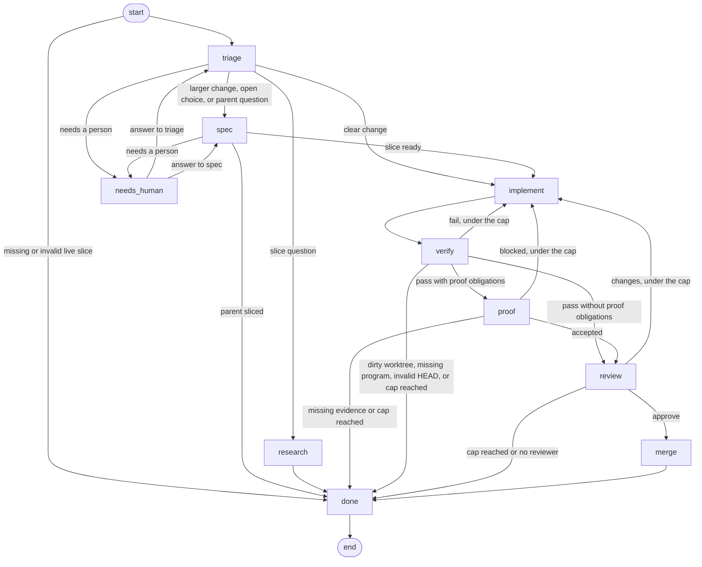

# Tools

Shared tools for the engine repositories. This repo lives in the bookout-labs organization. An engine does not copy it. The engine keeps a `tools.yaml` pointer.

`foreman` is the graph runner in this repo. Promptfoo grades the graph. Both are invoked from here, so every engine follows the same loop.

## Delivery graph



The edges are code. The model list is `src/foreman/models.toml`. Quota exhaustion tries the next model in that list, and if every model reports quota, the run halts with `quota_exhausted`. A missing CLI records `cli_missing` and may try the next installed CLI. Usage-name mismatches, Codex reroutes, and unrecognized errors never silently count as quota; they stop immediately as `invalid_output` and name what came back. Every model attempt (`ran`, `quota`, `cli_missing`, `stopped`) is recorded on the run. A node does not edit the list, and it does not decide the next node.

Review is a new session and starts with the first configured reviewer, including when that reviewer shares the builder's family. A review reports alignment, impact, verification, rollback, and error detection. It rates merge risk as low, medium, or high. The run log prints each review's own verdict, risk, and note. Invalid stage output stops with `invalid_output`. If the builder model is missing or every eligible reviewer is unavailable, the run stops with `no_reviewer`. The record includes `halt_detail` for both stops.

Live verify stops with `dirty_worktree` if the checkout has changes or Git cannot report a full HEAD SHA. Otherwise it runs the check command in the engine checkout and records that SHA if the check passes. Dry runs use a scripted verdict. When the check passes, the graph evaluates the browser and formal evidence required by the slice. Missing evidence stops the run. A failed proof consumes a round and sends the slice back to implement while rounds remain.

The cap is three failures in verify, proof, and review (`verify_rounds` and `review_rounds` tracked independently against `max_review_rounds = 3`). It is config. A node cannot raise it. A check that exits 126 or 127 stops once as `check_unavailable`, and environment errors such as `ECONNREFUSED` or an unresponsive local database halt immediately as `env_unavailable` without burning retry rounds. `--preflight` runs an optional environment probe before `implement`. Check outputs, watcher evidence, PR bodies, and review comments are scrubbed via `SecretRedactor` (`src/foreman/redaction.py`). Inline review comments and suggestions can be validated against annotated diffs (`src/foreman/review_validation.py`).

After approval, the live run reads the GitHub repository variable `FOREMAN_MERGE_HOLD` on the target engine repository. A non-empty value halts `merge_held` with that text and does not push or arm merge (`gh variable set` sets the hold and `gh variable delete` clears it). When unset or empty, the worktree must be clean and at the SHA from verify. The live run then pushes that slice branch, opens its pull request against `main` with a redacted Summary/Verification/Merge Risk body closing `#<issue>`, comments the reviewer, verdict, and risk, and runs `gh pr merge --auto --match-head-commit <sha>`.

Stage prompts live in `src/foreman/stages/`. Five Warp-derived YAML LLM-as-judge rubrics live in `src/foreman/scorers/<name>/scorer.md`. A node reads those files. It does not invent the loop.

A clear change that fits in one pull request goes straight to implement, even on a parent issue, and finishes as one pull request without filing slices. Changes that need more than one pull request or have an open product choice route to spec; parent issues whose triage is `spec` or `question` also route to spec. A ready parent spec records its slices and stops as `sliced`. Each child issue includes a fenced JSON object with its title, acceptance, dependency titles, screen path or empty string, and named PostgreSQL property constraints (`properties` holds named PostgreSQL constraints only; response checks stay in `acceptance`). Live runs load that object as the slice for the run. A `slice`-labelled issue with a missing or invalid object stops at `missing_slice`. An open product choice pauses a live run for a person's answer. An informational request on a slice routes to research.

When a run finishes with a halt, a failover, or an odd attempt (`stopped` or `cli_missing`), `finish()` stores a watcher proposal naming the evidence and file to change, stating that a person opens the pull request without editing the graph, merging, launching a coding agent, or changing `models.toml` or `max_review_rounds`. Quota failovers and `env_unavailable`/`budget_exceeded` halts never file graph issues. Clean runs file nothing. The live CLI prints the proposal and files one deduplicated open issue on `bookout-labs/tools` for graph-fix proposals.

A coordinator session reads `src/foreman/roles/coordinator.md` from the tools revision named in the engine. It files the parent issue and explains the run. It does not slice, build, or arm a merge.

## What enters the graph

`foreman accept` reads one event and either ignores it or prints the request. It does not call a model.

A GitHub event starts when it is `issue_labeled` and the labels include `factory`. `source: alert` stays ignored, while `source: alert_webhook` scrubs secrets/PII, assigns a deterministic `dedupe_key`, and emits a `draft_only` investigation request (ignoring `severity: info`).

```yaml
source: github
event: issue_labeled
labels: [factory]
title: Encode the timecode
body: The comment thread crashes.
```

```sh
foreman accept event.yaml
```

## Telemetry, scoring, self-improvement, and benchmarks

- **Spend, budget caps & multi-host stats**: `src/foreman/pricing.toml` defines reference token rates and default per-run soft/hard limits (`soft_usd`, `hard_usd`, `hard_tokens`). `foreman run` persists WAL telemetry to `~/.local/share/foreman/telemetry.sqlite3` tagged by hostname. View summaries or HTML SVG dashboards with `foreman stats [--refresh] [--format html --out stats.html]`, and sync across hosts via `foreman telemetry export` / `foreman telemetry import`.
- **LLM-as-judge scoring**: Five YAML-frontmatter scorers (`task-compliance`, `code-quality`, `efficiency`, `procedure-compliance`, `review-quality`) evaluate condensed, redacted transcripts (`src/foreman/transcripts.py`) using a cross-family judge (`src/foreman/scoring.py`). `insufficient_evidence` never passes and is excluded from averages and calibration denominators. Run `foreman scorers`, `foreman score [<run_id> | --all | --calibration]`, or `foreman run ... --score`.
- **Closed-loop self-improvement**: `foreman improve --run [--mode all|scorer|review|triage] [--dry-run | --apply | --open-pr] [--now]` aggregates failing runs, failing scorer grades, and GitHub feedback (`src/foreman/feedback.py`), enforcing 7-day cadence and a hard write-surface guard (`src/foreman/stages/`, `src/foreman/skills/`, `evals/`, `.agents/skills/*-local/` only; never `models.toml`, `measure.toml`, `pricing.toml`, workflows, or core Python). Legacy `foreman improve redundant-tests` remains supported.
- **Worktree benchmarking**: `foreman bench <suite> [--repo-path .] [--dry-run] [--format html --out bench.html]` runs suites such as `benchmarks/sample-triage` across isolated detached worktrees with publish/merge locked out and computes Pareto frontier recommendations (`highest_quality`, `most_efficient`, `lowest_cost_passing`).

Promptfoo runs the contract suite without calling a model:

```sh
sh evals/eval.sh
```

## Point an engine at it

Put this file at the root of the engine and name it `tools.yaml`.

```yaml
source: bookout-labs/tools
ref: main
graph: delivery
check: npm run check
```

Examples for the current engines are in `examples/`. `ref` should move from `main` to a tag once a graph change should wait for the engine to opt in.

Check a pointer:

```sh
foreman check-pointer tools.yaml
```

Walk the graph without calling a model:

```sh
foreman run delivery --dry-run --repo DoctorCRE/doctorcre-engine --request "Add a field" --check "npm run check"
```

Print the graph:

```sh
foreman diagram delivery
```

Start a live run from the root of the engine checkout. Use `--request` to supply the issue text when it is not available in the checkout.

```sh
foreman run delivery --repo DoctorCRE/doctorcre-engine --issue 42 --check "npm run check" --request "Add a field"
```

The runner uses the pinned model slugs from `models.toml` with the installed Codex, Claude, and Grok CLIs. SQLite saves state by repo and issue under `$XDG_STATE_HOME/foreman/checkpoints.sqlite3`, or `~/.local/state/foreman/checkpoints.sqlite3` by default. Run the same issue again from the same checkout to see its saved state. If you see a question, add `--answer "…"` to continue with the saved request and check command.

## Tests

```sh
uv sync
uv run python -m unittest discover -s tests
```
