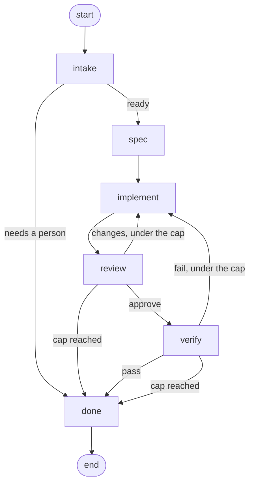

# Tools

Shared tools for the engine repositories. This repo lives in the bookout-labs organization. An engine does not copy it. The engine keeps a `tools.yaml` pointer.

`foreman` is the graph runner in this repo. Other tools can sit beside it later.

## Delivery graph



The edges are code. The model list is `src/foreman/models.toml`. Quota exhaustion tries the next model in that list. A node does not edit the list, and it does not decide the next node.

Review uses a different model family from the model that implemented the change.

The check command comes from the engine's pointer. Verify runs that command. It has no model.

The cap is three review or verify failures. It is config. A node cannot raise it.

## Point an engine at it

Put this file at the root of the engine and name it `tools.yaml`.

```yaml
source: bookout-labs/tools
ref: main
graph: delivery
check: npm run check
```

Examples for the current engines are in `examples/`. `ref` should move from `main` to a tag once a graph change should wait for the engine to opt in.

Check a pointer:

```sh
foreman check-pointer tools.yaml
```

Walk the graph without calling a model:

```sh
foreman run delivery --dry-run --repo DoctorCRE/doctorcre-engine --request "Add a field" --check "npm run check"
```

Print the graph:

```sh
foreman diagram delivery
```

A run without `--dry-run` stops. No live model dispatcher is connected yet.

## Tests

```sh
uv sync
uv run python -m unittest discover -s tests
```
