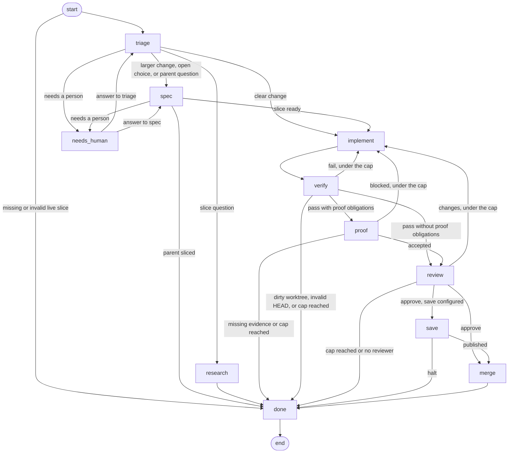

# Tools

Shared tools for the engine repositories. This repo lives in the bookout-labs organization. An engine does not copy it. The engine keeps a `tools.yaml` pointer.

`foreman` is the graph runner in this repo. Promptfoo grades the graph. Both are invoked from here, so every engine follows the same loop.

## Delivery graph



The edges are code. `src/foreman/models.toml` names model families and one effort. A router sends a small build to terra and a large, empty, risky, or retried build to sol. Quota exhaustion tries the next family, and if every model reports quota, the run halts with `quota_exhausted`. A missing CLI records `cli_missing` and may try the next installed CLI. Usage-name mismatches, Codex reroutes, and unrecognized errors never silently count as quota; they stop immediately as `invalid_output` and name what came back. Every model attempt (`ran`, `quota`, `cli_missing`, `stopped`) is recorded on the run. A live run asks the installed CLI for the newest model in the chosen family. A node does not edit the list, and it does not decide the next node. A dry run prints the family and the reason for each model node.

Review is a new session and starts with the first configured reviewer, including when that reviewer shares the builder's family. A review reports alignment, impact, verification, rollback, and error detection. It rates merge risk as low, medium, or high. Invalid stage output stops with `invalid_output`. If the builder model is missing or every eligible reviewer is unavailable, the run stops with `no_reviewer`. The record includes `halt_detail` for both stops.

Live verify stops with `dirty_worktree` if the checkout has changes or Git cannot report a full HEAD SHA. Otherwise it runs the check command in the engine checkout and records that SHA if the check passes. Dry runs use a scripted verdict. When the check passes, the graph evaluates the browser and formal evidence required by the slice. Missing evidence stops the run. A failed proof consumes a round and sends the slice back to implement while rounds remain.

The cap is three failures across verify, proof, and review. It is config. A node cannot raise it.

After approval, a pointer with a save block pushes that clean reviewed HEAD and opens or updates the pull request. The commit stays the one verify recorded. Before the live merge node records `gh pr merge --auto --match-head-commit <sha>` with that SHA, it reads the GitHub repository variable `FOREMAN_MERGE_HOLD` on the target engine repository. A non-empty value halts `merge_held` with that text and does not arm merge (`gh variable set` sets the hold and `gh variable delete` clears it). When unset or empty, a pointer without a save block goes from approval to the merge node, the worktree must still be clean and at that SHA for the command to run, and the CLI also requires an open pull request at that SHA with a head branch starting with the issue number and a hyphen and a base branch of `main`.

Stage prompts live in `src/foreman/stages/`. The code-quality skill supplies the scorer rubric. The merge-risk skill is attached to review. A node reads those files. It does not invent the loop.

A clear change that fits in one pull request goes straight to implement, even on a parent issue, and finishes as one pull request without filing slices. Changes that need more than one pull request or have an open product choice route to spec; parent issues whose triage is `spec` or `question` also route to spec. A ready parent spec records its slices and stops as `sliced`. Each child issue includes a fenced JSON object with its title, acceptance, dependency titles, screen path or empty string, and named PostgreSQL property constraints (`properties` holds named PostgreSQL constraints only; response checks stay in `acceptance`). Live runs load that object as the slice for the run. A `slice`-labelled issue with a missing or invalid object stops at `missing_slice`. An open product choice pauses a live run for a person's answer. An informational request on a slice routes to research.

When a run finishes with a halt, a failover, or an odd attempt (`stopped` or `cli_missing`), `finish()` stores a watcher proposal naming the evidence and file to change, stating that a person opens the pull request without editing the graph, merging, launching a coding agent, or changing `models.toml` or `max_review_rounds`. Quota failovers are reported as quota with no graph change. Clean runs file nothing. The live CLI prints the proposal and files one deduplicated open issue on `bookout-labs/tools` for graph-fix proposals.

A coordinator session reads `src/foreman/roles/coordinator.md` from the tools revision named in the engine. It files the parent issue and explains the run. It does not slice, build, or arm a merge.

## What enters the graph

`foreman accept` reads one event and either ignores it or prints the request. It does not call a model.

A GitHub event starts when it is `issue_labeled` and the labels include `factory`. The command ignores alerts and other GitHub events. It rejects unknown sources.

```yaml
source: github
event: issue_labeled
labels: [factory]
title: Encode the timecode
body: The comment thread crashes.
```

```sh
foreman accept event.yaml
```

## Scoring

`src/foreman/measure.toml` holds the sampling rate, the passing bar, and the label scores. One implementation run in every ten is sampled for scoring. Merge arming uses verification and review independently of scoring.

- `approve` scores 1 and passes.
- `block` scores 0.2 and fails. A produced artifact that fails its proof or screen check is `block`.
- `insufficient_evidence` scores 0.5 and always remains a distinct non-pass. A missing required proof or browser trace leaves the work unjudged.

`foreman improve` proposes a change for a known scoring failure. For redundant tests, it targets the builder instructions in `src/foreman/stages/implement.md`. The proposal does not change `models.toml` or the review cap. A person opens the pull request.

```sh
foreman improve redundant-tests
```

Promptfoo runs the same contract without a model:

```sh
sh evals/eval.sh
```

## Point an engine at it

Put this file at the root of the engine and name it `tools.yaml`.

```yaml
source: bookout-labs/tools
ref: main
graph: delivery
check: npm run check
```

Examples for the current engines are in `examples/`. `ref` should move from `main` to a tag once a graph change should wait for the engine to opt in.

Check a pointer:

```sh
foreman check-pointer tools.yaml
```

Walk the graph without calling a model:

```sh
foreman run delivery --dry-run --repo DoctorCRE/doctorcre-engine --request "Add a field" --check "npm run check"
```

Print the graph:

```sh
foreman diagram delivery
```

Start a live run from the root of the engine checkout. Use `--request` to supply the issue text when it is not available in the checkout.

```sh
foreman run delivery --repo DoctorCRE/doctorcre-engine --issue 42 --check "npm run check" --request "Add a field"
```

The runner resolves each family with the installed Codex, Claude, and Grok CLIs. SQLite saves state by repo and issue under `$XDG_STATE_HOME/foreman/checkpoints.sqlite3`, or `~/.local/state/foreman/checkpoints.sqlite3` by default. Run the same issue again from the same checkout to see its saved state. If you see a question, add `--answer "…"` to continue with the saved request and check command.

`foreman save` commits the named files, pushes the branch, and opens or updates a pull request. The optional `save` block in `tools.yaml` supplies the GitHub App, the privacy list, the work-id pattern, the board repository, whether proof is required, and whether to queue the pull request. A pointer without `save` still validates. Repositories that leave `app` unset use the ambient `gh` login. A live delivery run with a save block uses those same gates after review accepts, pushes the reviewed commit, and opens the pull request. The merge node then arms `gh pr merge --auto --match-head-commit`. Standalone `foreman save` with `queue: true` still queues with `gh pr merge --auto`.

```sh
foreman save --work LAB.1.3 -m "what changed" --issue 2 --proof "Shown on the board." docs/note.md
```

## Tests

```sh
uv sync
uv run python -m unittest discover -s tests
```
