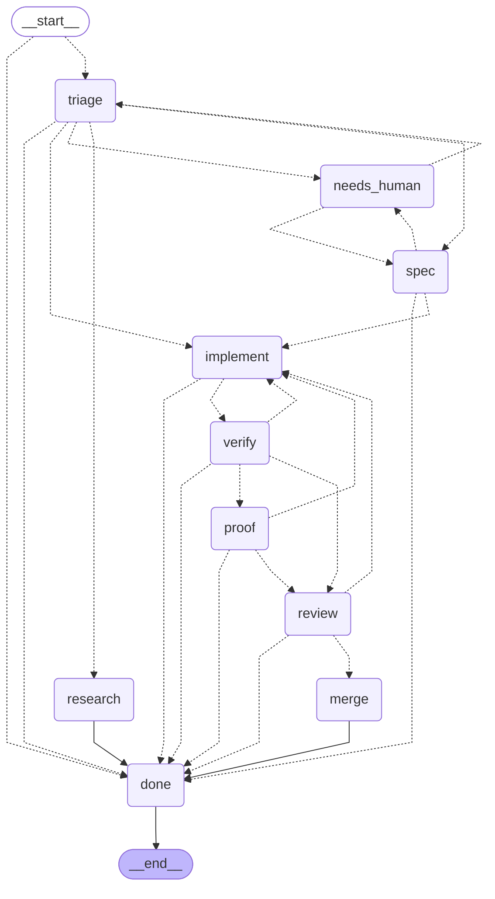

# Tools

Shared tools for the engine repositories. This repo lives in the bookout-labs organization. An engine does not copy it. The engine keeps a `tools.yaml` pointer.

`foreman` is the graph runner in this repo. Promptfoo grades the graph. Both are invoked from here, so every engine follows the same loop.

## Delivery graph



Generate the diagram with `foreman diagram delivery`. The model list is `src/foreman/models.toml`. Quota exhaustion or a missing CLI tries the next model in that list. A node does not edit the list, and it does not decide the next node.

Review excludes every model family that implemented any round of the change. A review reports alignment, impact, verification, rollback, and error detection. It rates merge risk as low, medium, or high. Invalid stage output stops with `invalid_output`. If every eligible CLI is missing, the run stops with `cli_missing`. If the graph cannot select a reviewer from a different model family, the run stops with `no_reviewer`. The record includes `halt_detail` for these stops.

Live verify stops with `dirty_worktree` if the checkout has changes or Git cannot report a full HEAD SHA. Otherwise it runs the check command in the engine checkout and records that SHA if the check passes. Dry runs use a scripted verdict. When the check passes, the graph evaluates the browser and formal evidence required by the slice. Missing evidence stops the run. A failed proof consumes a round and sends the slice back to implement while rounds remain.

The cap is three failures across verify, proof, and review. It is config. A node cannot raise it.

After approval, Foreman looks up the pull request for the checked-out branch and arms it with `gh pr merge <pull-request> --repo <repo> --squash --auto --match-head-commit <sha>`. The worktree and pull request must still be at the verified SHA, the worktree must be clean, and the open pull request must target `main` from a branch starting with the issue number and a hyphen.

Foreman looks up the local branch by name. If the pull request uses a differently named upstream branch, the lookup fails and Foreman leaves the merge unarmed.

Before arming, Foreman reads the target repository's GitHub Actions variable `FOREMAN_MERGE_HOLD`. A non-empty value or a read error pauses the run as `merge_held` and records the value or error. An unset or empty value permits arming. Clear the hold or resolve the read error, then rerun the same command to retry the merge.

If the merge command times out, Foreman checks the same pull request at the verified SHA. An open pull request with a squash auto-merge request or a merged pull request confirms the result. A failed merge check or unconfirmed command pauses the run as `merge_not_armed` and records the reason. Resolve it and rerun the same command to retry. If HEAD moved, run `git reset --keep <verified-sha>` on the PR branch before rerunning. New commits need a new run. A dry run prints `merge skipped (dry run)` with the command template and reports the scripted verification result.

Stage prompts live in `src/foreman/stages/`. The graph selects worker methods from the rule table and validated delivery state. The code-quality skill supplies the scorer rubric.

Before live dispatch, Foreman exports the pstack skills from the repository and commit pinned in `src/foreman/config.py`. It records that pin in the checkpoint and reuses it on resume. A failed fetch or export stops with `skill_missing` and reports `pin unavailable` with the commit. A missing method in a successful export reports `method missing at pin` with the path and commit. Dry runs print `pstack pin not checked (dry run)`.

A parent or slice goes straight to implement when the behavior is decided and the change fits in one pull request. A parent on this route is its own slice. It carries the same proof obligations as any slice and files no child issues. Changes that need more than one pull request or leave a product choice open go to spec. An informational request goes to spec on a parent and to research on a slice. An open product choice pauses a live run for a person's answer.

A ready parent spec records its slices and stops as `sliced`. Each child issue carries the slice and the parent's work classification in fenced JSON.

```json
{
  "title": "Keep the selected item on refresh",
  "acceptance": "The selected item remains selected after refresh.",
  "depends_on": [],
  "screen": "",
  "properties": [],
  "stateful": true,
  "work_kind": "bug_fix"
}
```

`stateful` is a boolean. `work_kind` is one of `feature`, `bug_fix`, `refactoring`, or `perf_issue`. Old issues without these fields default to a stateless slice and get their classification during triage. A `slice`-labelled issue with a missing or invalid JSON object stops at `missing_slice`.

A coordinator session reads `src/foreman/roles/coordinator.md` from the tools revision named in the engine. It files the parent issue and explains the run. It does not slice, build, or arm a merge.

## What enters the graph

`foreman accept` reads one event and either ignores it or prints the request. It does not call a model.

A GitHub event starts when it is `issue_labeled` and the labels include `factory`. The command ignores alerts and other GitHub events. It rejects unknown sources.

```yaml
source: github
event: issue_labeled
labels: [factory]
title: Encode the timecode
body: The comment thread crashes.
```

```sh
foreman accept event.yaml
```

## Scoring

`src/foreman/measure.toml` holds the sampling rate, the passing bar, and the label scores. One implementation run in every ten is sampled for scoring. Merge arming uses verification and review independently of scoring.

- `approve` scores 1 and passes.
- `block` scores 0.2 and fails. A produced artifact that fails its proof or screen check is `block`.
- `insufficient_evidence` scores 0.5 and always remains a distinct non-pass. A missing required proof or browser trace leaves the work unjudged.

`foreman improve` proposes a change for a known scoring failure. For redundant tests, it targets the builder instructions in `src/foreman/stages/implement.md`. The proposal does not change `models.toml` or the review cap. A person opens the pull request.

```sh
foreman improve redundant-tests
```

Promptfoo runs the same contract without a model:

```sh
sh evals/eval.sh
```

## Point an engine at it

Put this file at the root of the engine and name it `tools.yaml`.

```yaml
source: bookout-labs/tools
ref: main
graph: delivery
check: npm run check
```

Examples for the current engines are in `examples/`. `ref` should move from `main` to a tag once a graph change should wait for the engine to opt in.

Check a pointer:

```sh
foreman check-pointer tools.yaml
```

Walk the graph without calling a model:

```sh
foreman run delivery --dry-run --repo DoctorCRE/doctorcre-engine --request "Add a field" --check "npm run check"
```

Print the graph:

```sh
foreman diagram delivery
```

Start a live run from the root of the engine checkout. Use `--request` to supply the issue text when it is not available in the checkout.

```sh
foreman run delivery --repo DoctorCRE/doctorcre-engine --issue 42 --check "npm run check" --request "Add a field"
```

The runner uses the pinned model slugs from `models.toml` with the installed Codex, Claude, and Grok CLIs. SQLite saves state by repo and issue under `$XDG_STATE_HOME/foreman/checkpoints.sqlite3`, or `~/.local/state/foreman/checkpoints.sqlite3` by default. Run the same issue again from the same checkout to see its saved state. If you see a question, add `--answer "…"` to continue with the saved request and check command.

If the live command prints `paused quota_exhausted`, run it again from the same checkout after quota returns. Foreman retries the same stage and retains its earlier attempt records.

## Tests

```sh
uv sync
uv run python -m unittest discover -s tests
```
