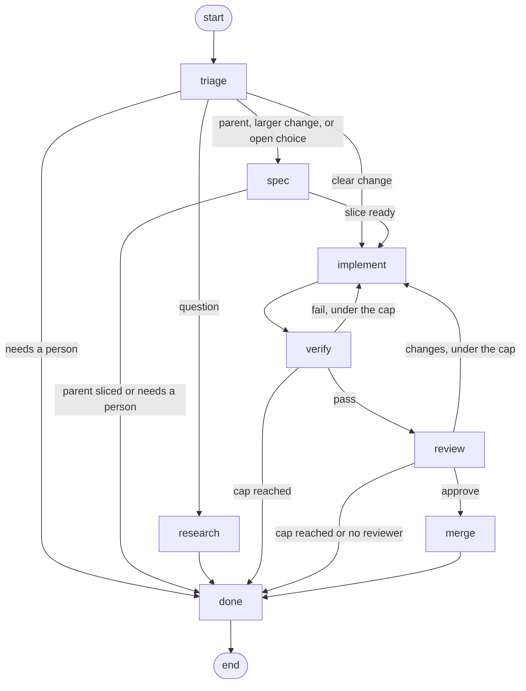

# Tools

Shared tools for the engine repositories. This repo lives in the bookout-labs organization. An engine does not copy it. The engine keeps a `tools.yaml` pointer.

`foreman` is the graph runner in this repo. Promptfoo grades the graph. Both are invoked from here, so every engine follows the same loop.

## Delivery graph



The edges are code. The model list is `src/foreman/models.toml`. Quota exhaustion tries the next model in that list. A node does not edit the list, and it does not decide the next node.

Review uses a different model family from the model that implemented the change. A review reports alignment, impact, verification, rollback, and error detection. It rates merge risk as low, medium, or high. Invalid stage output stops with `invalid_output`. If the builder model is missing or every eligible reviewer is unavailable, the run stops with `no_reviewer`. The record includes `halt_detail` for both stops.

The check command comes from the engine's pointer and is attached to verify. Verify has no model and records its result before review. A live run is not connected, so dry runs use a scripted result. After approval, the merge node records `merge_armed` when verify passed and implement reported a `head_sha`. Arming is a record update only.

The cap is three review or verify failures. It is config. A node cannot raise it.

Stage prompts live in `src/foreman/stages/`. The code-quality skill supplies the scorer rubric. The merge-risk skill is attached to review. A node reads those files. It does not invent the loop.

A clear change on a slice goes straight to implement. Parent issues and changes that need more than one pull request route to spec even when the decisions are settled. A ready parent spec records its slices and stops as `sliced`. Each slice records its title, acceptance, dependency titles, screen path or empty string, and named property constraints. These fields record proof obligations for later executors. An open product choice stops for a person. An informational request routes to research.

A coordinator session reads `src/foreman/roles/coordinator.md` from the tools revision named in the engine. It files the parent issue and explains the run. It does not slice, build, or arm a merge.

## What enters the graph

`foreman accept` reads one event and either ignores it or prints the request. It does not call a model.

A GitHub event starts when it is `issue_labeled` and the labels include `factory`. The command ignores alerts and other GitHub events. It rejects unknown sources.

```yaml
source: github
event: issue_labeled
labels: [factory]
title: Encode the timecode
body: The comment thread crashes.
```

```sh
foreman accept event.yaml
```

## Scoring

`src/foreman/measure.toml` holds the sampling rate, the passing bar, and the label scores. One implementation run in every ten is graded. `approve` scores 1 and passes. `block` scores 0.2 and fails. `insufficient_evidence` scores 0.5 and always fails, regardless of the passing bar.

`foreman improve` proposes a change for a known scoring failure. For redundant tests, it targets the builder instructions in `src/foreman/stages/implement.md`. The proposal does not change `models.toml` or the review cap. A person opens the pull request.

```sh
foreman improve redundant-tests
```

Promptfoo runs the same contract without a model:

```sh
sh evals/eval.sh
```

## Point an engine at it

Put this file at the root of the engine and name it `tools.yaml`.

```yaml
source: bookout-labs/tools
ref: main
graph: delivery
check: npm run check
```

Examples for the current engines are in `examples/`. `ref` should move from `main` to a tag once a graph change should wait for the engine to opt in.

Check a pointer:

```sh
foreman check-pointer tools.yaml
```

Walk the graph without calling a model:

```sh
foreman run delivery --dry-run --repo DoctorCRE/doctorcre-engine --request "Add a field" --check "npm run check"
```

Print the graph:

```sh
foreman diagram delivery
```

A run without `--dry-run` stops. No live model dispatcher is connected yet.

## Tests

```sh
uv sync
uv run python -m unittest discover -s tests
```
