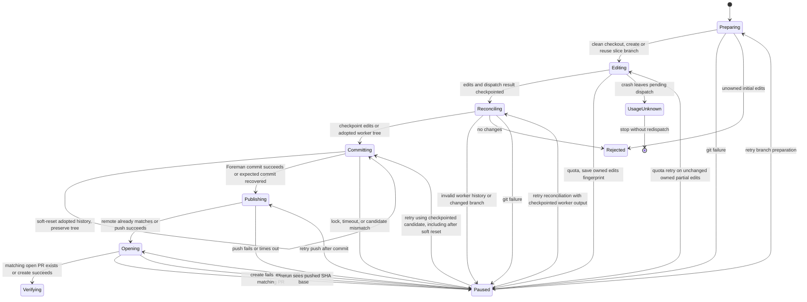

# Publication recovery

This statechart abstracts publication recovery. The [native delivery graph](graph/delivery.mmd) shows the graph topology.

The checkpoint owns the attempt's starting HEAD, branch, dispatch result, and reconciled candidate. Git owns commits and remote refs. Forge owns the open PR. Preparation precedes worker edits. Reconciliation checkpoints either the edits fingerprint or an adopted worker HEAD, tree, and fingerprint before commit. A clean worker history is adopted only on the delivery branch, with nonempty linear commits after the attempt head, a net tree change, and a remote branch that is absent or still at the attempt head. Foreman soft-resets adopted commits to the attempt head and creates its own commit with attribution and redaction, preserving the adopted tree. Commit recovery accepts the expected parent and complete message, and checks the tree for an adopted candidate. Push compares the remote branch SHA. PR lookup matches the repository head and base.

New delivery branches start at the current origin base fetched during preparation. The fetch uses repository-scoped App credentials when configured and resolves the fetched ref once to a full SHA. Stale or missing local base branches have no effect. This policy also applies to tools itself and clean detached checkouts whose HEAD is newer or divergent. Detached commits and local main remain unchanged.

An existing delivery branch retains its inspected HEAD for correction and repair attempts, after any repair refresh. If preparation was interrupted after branch creation but before checkpointing, replay reuses that branch without fetching a new parent. When the checkout is not already attached to the delivery branch, that branch must equal the fetched origin base tip before switching to it. Otherwise preparation preserves the checkout and asks the operator to switch to the delivery branch to reuse it or delete it before rerunning. A checkpointed attempt retains its saved parent when origin advances.

The attempt parent and PR comparison base serve different purposes. Reconciliation fetches origin again and computes the merge base for the entire PR. A force rewind can yield a comparison base older than the attempt parent. Unrelated rewritten history or missing shallow ancestry halts with the checkout preserved and instructions to fetch the needed history. Fresh depth-one clones work without automatic deepening.

Smoke compares its fixture against the merge base with the origin ref fetched during preparation, excluding unrelated origin changes between clone and prepare.

Only one writer owns a checkout. Fingerprints reject foreign edits after a quota stop and changed implementation edits after reconciliation. An interrupted dispatch with unknown usage stops as `usage_unknown` without repeating the worker. A quota stop can continue unchanged partial edits. Publication Git and gh calls have timeouts. Git disables credential prompts, and publication gh calls receive no stdin. Recoverable failures halt for explicit retry.

## Transition tests

All names below are methods in `tests/test_publication.py`.

| Transition or crash window | Test |
| --- | --- |
| New attempt to prepared branch | `test_graph_commits_and_pushes_before_opening_one_pull_request` |
| Prepared branch exists, retry preparation | `test_existing_branch_at_expected_base_is_reused` |
| Branch created before checkpoint, crash and retry | `test_crash_windows_resume_without_duplicate_completed_work` |
| Preparation lock, halt and retry | `test_index_lock_is_resumable` |
| Worker edits to checkpointed result | `test_graph_commits_and_pushes_before_opening_one_pull_request` |
| Crash during worker dispatch, stop with `usage_unknown` without redispatch | `test_crash_during_worker_stops_with_unknown_usage` |
| Quota halt, retry same partial edits | `test_quota_stop_continues_owned_partial_edits` |
| Foreign changes after quota halt, reject | `test_foreign_edits_after_quota_stop_are_rejected` |
| Unowned initial edits, reject | `test_dirty_initial_worktree_has_specific_detail` |
| Empty worker commit, halt, preserve checkout, rerun after restore | `test_worker_commit_is_detected_using_the_actual_head` |
| Clean, unpublished, nonempty linear worker history, adopt tree and replace with Foreman commit | `test_worker_tree_replays_reconciliation_and_publication` |
| Crash before or after soft reset, resume from candidate without repeating worker or reconciliation | `test_worker_tree_replays_reconciliation_and_publication` |
| Adopted tree committed before checkpoint, recover Foreman commit | `test_worker_tree_replays_reconciliation_and_publication` |
| Invalid worker history or changed branch, halt, preserve checkout, rerun after restore | `test_worker_history_rejections_preserve_checkout_and_usage` |
| Restore rejected worker history as edits, rerun to verified | `test_recovery_with_edits_uses_reconciled_fingerprint` |
| Reconcile git timeout or lock, halt and retry reconciliation | `test_reconcile_git_errors_remain_git_failed` |
| Extra commit after reconciliation, halt at commit | `test_reconciled_candidate_mutation_is_rejected_before_publication` |
| Worker produces no edits, reject | `test_no_changes_fails_without_pushing` |
| Completed worker checkpoint, crash before commit, retry commit | `test_crash_windows_resume_without_duplicate_completed_work` |
| Commit lock, halt and retry commit | `test_index_lock_is_resumable` |
| Commit finishes before checkpoint, crash and recover | `test_crash_windows_resume_without_duplicate_completed_work` |
| Commit to pushed remote | `test_graph_commits_and_pushes_before_opening_one_pull_request` |
| Rejected push, halt and retry | `test_publication_failures` |
| Missing remote, halt | `test_publication_failures` |
| Wrong push URL, reject before network | `test_publication_failures` |
| Push finishes, crash and skip duplicate push | `test_crash_windows_resume_without_duplicate_completed_work` |
| Missing PR, create then verify | `test_graph_commits_and_pushes_before_opening_one_pull_request` |
| PR create failure, halt and retry | `test_rerun_retries_publication_without_rerunning_the_worker` |
| PR creation finishes, crash and reuse PR | `test_crash_windows_resume_without_duplicate_completed_work` |
| Existing PR on wrong base, halt | `test_wrong_base_open_pr_stops_without_creation` |
| Review changes, next attempt on same branch and PR | `test_second_attempt_adds_a_commit_to_the_same_pull_request` |
| Fetch, push, ls-remote and commit timeout, typed failure | `test_git_calls_disable_prompts_and_bound_network_and_commit` |
| Authentication fails under a pseudo-terminal, return | `test_auth_failure_under_pty_returns_without_prompting` |
| Repository default drives branch, PR and merge | `test_repository_default_branch` |
