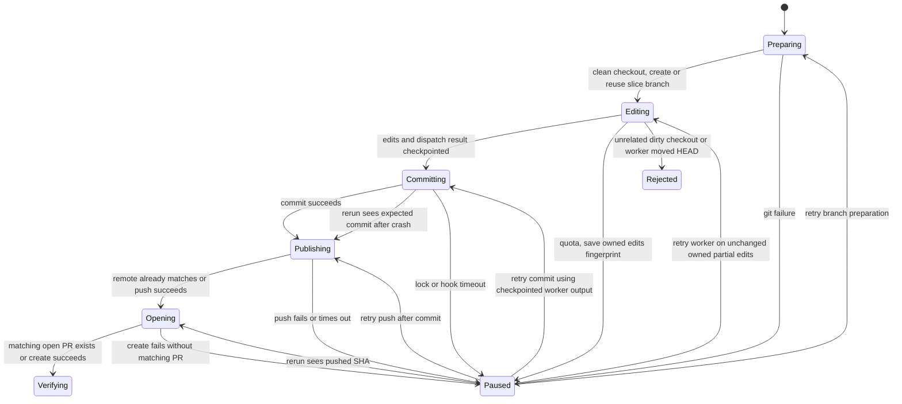

# Publication recovery

Throughput checkpoint. One serial builder owns workspace and graph changes. Independent checks run together after recovery tests pass. No live graph writes are permitted in verification.

The checkpoint owns the attempt's starting HEAD, branch, model dispatch result and worker edits fingerprint. Git owns completed commits and remote refs. Forge owns the open PR. Each step reads those observations before writing. A prepared checkpoint precedes worker edits. A completed worker checkpoint precedes commit. Commit recovery accepts only the single expected commit whose parent and complete message match the checkpoint. Push compares the remote branch SHA; PR lookup uses the same parsed branch lookup as review.

Crashes before preparation, after branch creation, during edits, before commit, after commit, after push and after PR creation resume at their current checkpoint. Observations skip finished writes. A crash inside worker execution can repeat that uncompleted worker invocation; finished, checkpointed worker invocations never repeat. External changes after a quota stop are rejected by the fingerprint. No parallel writers are supported for one checkout.

System design. One checkout and SQLite checkpoint per run; no queues, cache or fanout. At 10x load independent workspaces remain required. Git and gh have bounded calls; one failure halts the graph for explicit retry. Branch plus expected parent/message identifies a commit; branch/ref/SHA identifies a push; same repository head/base identifies a PR. No automatic retry loop or circuit breaker counter is needed.
