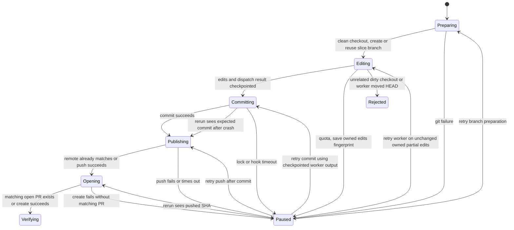

# Publication recovery

Throughput checkpoint. One serial builder owns workspace and graph changes. Independent checks run together after recovery tests pass. No live graph writes are permitted in verification.

The checkpoint owns the attempt's starting HEAD, branch, model dispatch result and worker edits fingerprint. Git owns completed commits and remote refs. Forge owns the open PR. Each step reads those observations before writing. A prepared checkpoint precedes worker edits. A completed worker checkpoint precedes commit. Commit recovery accepts only the single expected commit whose parent and complete message match the checkpoint. Push compares the remote branch SHA; PR lookup uses the same parsed branch lookup as review.

Crashes before preparation, after branch creation, during edits, before commit, after commit, after push and after PR creation resume at their current checkpoint. Observations skip finished writes. A crash inside worker execution can repeat that uncompleted worker invocation; finished, checkpointed worker invocations never repeat. External changes after a quota stop are rejected by the fingerprint. No parallel writers are supported for one checkout.

System design. One checkout and SQLite checkpoint per run; no queues, cache or fanout. At 10x load independent workspaces remain required. Git and gh have bounded calls; one failure halts the graph for explicit retry. Branch plus expected parent/message identifies a commit; branch/ref/SHA identifies a push; same repository head/base identifies a PR. No automatic retry loop or circuit breaker counter is needed.

## Transition tests

All names below are methods in `tests/test_publication.py`.

| Transition or crash window | Test |
| --- | --- |
| New attempt to prepared branch | `test_graph_commits_and_pushes_before_opening_one_pull_request` |
| Prepared branch exists, retry preparation | `test_existing_branch_at_expected_base_is_reused` |
| Branch created before checkpoint, crash and retry | `test_crash_after_branch_creation_reuses_branch` |
| Preparation lock, halt and retry | `test_index_lock_during_prepare_retries_before_worker` |
| Worker edits to checkpointed result | `test_graph_commits_and_pushes_before_opening_one_pull_request` |
| Crash during edits, retry unfinished worker | `test_crash_during_worker_continues_partial_edits` |
| Quota halt, retry same partial edits | `test_quota_stop_continues_owned_partial_edits` |
| Foreign changes after quota halt, reject | `test_foreign_edits_after_quota_stop_are_rejected` |
| Unowned initial edits, reject | `test_dirty_initial_worktree_has_specific_detail` |
| Worker moves HEAD, reject | `test_worker_commit_is_detected_using_the_actual_head` |
| Worker produces no edits, reject | `test_no_changes_fails_without_pushing` |
| Completed worker checkpoint, crash before commit, retry commit | `test_crash_after_worker_checkpoint_never_repeats_worker` |
| Commit lock, halt and retry commit | `test_index_lock_is_resumable_without_repeating_worker` |
| Commit finishes before checkpoint, crash and recover | `test_crash_after_commit_recovers_without_worker_or_second_commit` |
| Commit to pushed remote | `test_graph_commits_and_pushes_before_opening_one_pull_request` |
| Rejected push, halt and retry | `test_push_rejection_halts_and_retry_converges` |
| Missing remote, halt | `test_missing_remote_halts_with_detail` |
| Wrong push URL, reject before network | `test_wrong_push_remote_is_rejected_before_network` |
| Push finishes, crash and skip duplicate push | `test_crash_after_push_skips_finished_push` |
| Missing PR, create then verify | `test_graph_commits_and_pushes_before_opening_one_pull_request` |
| PR create failure, halt and retry | `test_rerun_retries_publication_without_rerunning_the_worker` |
| PR creation finishes, crash and reuse PR | `test_crash_after_pr_create_reuses_pr` |
| Existing PR on wrong base, reject | `test_wrong_base_open_pr_stops_without_creation` |
| Review changes, next attempt on same branch and PR | `test_second_attempt_adds_a_commit_to_the_same_pull_request` |
| Fetch, push, ls-remote and commit timeout, typed failure | `test_git_calls_disable_prompts_and_bound_network_and_commit` |
| Authentication fails under a pseudo-terminal, return | `test_auth_failure_under_pty_returns_without_prompting` |
| Repository default drives branch, PR and merge | `test_repository_default_branch_drives_branch_pr_and_merge` |

The statechart tool generated `.tmp/Publication.tla`, `.tmp/Publication.cfg` and `.tmp/Publication.map.mjs` from `.tmp/publication.mmd`. Command `node /Users/booko/.claude/plugins/marketplaces/cursor-plugins/pstack/skills/statechart/scripts/statechart.mjs from-chart "$PWD/.tmp/publication.mmd" --out "$PWD/.tmp/statechart"` stopped with exit 2 because this machine has neither TLC nor a Java runtime. No formal-model verification is claimed. The tests above replay the chart against the real graph, SQLite checkpoints, local Git checkouts and bare remotes.

Model the Domain shaped the choice of graph nodes and checkpoint fields. Make Operations Idempotent shaped commit reconciliation and the remote SHA comparison. The code has no publication journal separate from the existing SQLite checkpointer.

## Verification record

The original 6e3de512 checkout reproduced the crash-after-commit defect with a local Git repository and SQLite checkpoint. Rerunning invoked the worker twice, then stopped at `failed: no changes`. The fixed graph's crash-after-commit test observes the original commit pushed with no duplicate worker or commit.

The merged b67cc3c base retains `--preflight`, `env_unavailable`, `ResumableHalt` and `Runtime[LiveRun]`. Resuming every publication halt creates the same invocation context as a new run. The environment tests cover probe timing, quota-independent round counts and answer replay.

Local verification passed 252 unit tests, 12 evals, the README dry run with `done verified`, and `git diff --check`. After merging the conflicting 23ede48 type gate, Pyright 1.1.414 checked all source modules under the repository strict configuration and passed with zero errors and zero warnings. No casts or ignore directives were added. The six basic-mode modules are the unchanged exceptions allowed by the type gate.

Against 23ede48 the diff contains 287 changed source lines and 706 handwritten test lines. Fixtures and generated schemas add 51 lines and are excluded from T5. The coordinator's no-split ruling is recorded in issue #55. Crash recovery and publication remain one contract.

PRODUCTION PROOF for this PR is fixture-only by instruction. `TMPDIR="$PWD/.tmp" uv run python -m unittest discover -s tests -p test_publication.py` must exit 0. Its pass path ends with an open PR fixture and matching local/remote HEAD; failure cases stop with typed, detailed halts. The pty authentication server, local bare remotes and all fixtures use synthetic data. No live delivery graph run was used.

The hosted Linux run exposed a fixture that inherited a global Git author. The real-checkout reset fixture now configures a synthetic author explicitly and passes with global Git configuration disabled. The controlling-pty test waits within its deadline for the child exit status after terminal EOF; ten consecutive runs passed with global Git configuration disabled.

GitHub reported a real conflict with 23ede48. A normal merge retained its strict type gate, validated checkpoint/result types and native Codex output. The final merged local suite passed 252 tests and 12 evals.
